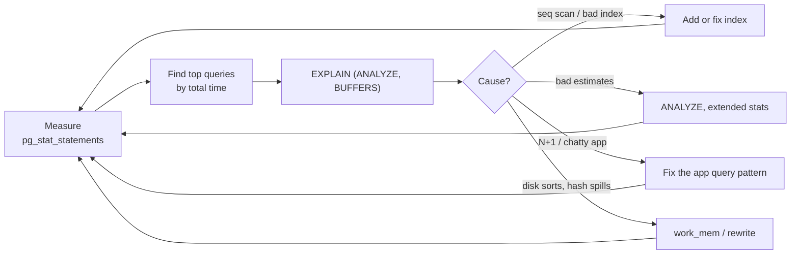

# PostgreSQL Performance Tuning and Extensions

Most PostgreSQL performance problems are solved by a better query or index, not by a magic config setting. This guide gives you a methodical process: find the expensive queries, read their plans, fix them, then tune the server where it genuinely helps. It also covers the extensions that make PostgreSQL a general-purpose platform for search, geospatial queries, time series and vector embeddings.

## 1. The tuning process



Work in **total time** (calls × mean). A 2 ms query called 5 million times a day matters more than a 3-second report that runs once.

## 2. Find the expensive queries: pg_stat_statements

```sql
-- Enable once: shared_preload_libraries = 'pg_stat_statements' (needs a restart)
CREATE EXTENSION IF NOT EXISTS pg_stat_statements;

SELECT round(total_exec_time::numeric / 1000, 1) AS total_s,
       calls,
       round(mean_exec_time::numeric, 2) AS mean_ms,
       round(100 * shared_blks_hit::numeric / nullif(shared_blks_hit + shared_blks_read, 0), 1) AS cache_hit_pct,
       left(query, 100) AS query
FROM pg_stat_statements
ORDER BY total_exec_time DESC
LIMIT 10;
```

Also turn on `log_min_duration_statement = '500ms'` and the **auto_explain** module to log the plans of slow queries automatically. When a production problem happens at 3 a.m., the evidence is already in the logs.

## 3. Reading EXPLAIN ANALYZE

```sql
EXPLAIN (ANALYZE, BUFFERS)
SELECT o.id, o.total
FROM orders o
WHERE o.restaurant_id = 17 AND o.status = 'PREPARING'
ORDER BY o.created_at DESC
LIMIT 20;
```

```text
Limit  (cost=0.43..52.10 rows=20) (actual time=0.041..0.180 rows=20 loops=1)
  ->  Index Scan Backward using orders_rest_status_created on orders o
        Index Cond: ((restaurant_id = 17) AND (status = 'PREPARING'))
        Buffers: shared hit=24
Planning Time: 0.2 ms
Execution Time: 0.21 ms
```

How to read a plan:

- Read **inside-out**: the most indented node runs first.
- Compare **estimated `rows`** with **actual `rows`**. A big mismatch (estimated 1, actual 80,000) means bad statistics and usually a bad join choice.
- **`Buffers: shared read`** means disk reads. `hit` means it was served from cache.
- Warning signs: `Seq Scan` on a big table with a selective filter, `Sort Method: external merge Disk`, `Rows Removed by Filter` in the millions, and `Nested Loop` with a huge number of loops.

Paste a plan into **explain.dalibo.com** or **explain.depesz.com** for a visual, annotated view.

## 4. Index strategies that fix most problems

```sql
-- Composite index matching filter + sort: equality columns first, then the range or sort column
CREATE INDEX CONCURRENTLY orders_rest_status_created
  ON orders (restaurant_id, status, created_at DESC);

-- Partial index: only the rows you actually query (small and fast)
CREATE INDEX CONCURRENTLY orders_active
  ON orders (restaurant_id, created_at DESC)
  WHERE status IN ('PLACED', 'PREPARING', 'OUT_FOR_DELIVERY');

-- Covering index: include extra columns so the query never touches the table
CREATE INDEX CONCURRENTLY orders_user_cover
  ON orders (user_id, created_at DESC) INCLUDE (total, status);

-- Expression index: for queries on a function of a column
CREATE INDEX CONCURRENTLY users_email_lower ON users (lower(email));

-- JSONB containment queries
CREATE INDEX CONCURRENTLY events_payload_gin ON events USING GIN (payload jsonb_path_ops);
```

- Always use **`CONCURRENTLY`** in production. A plain `CREATE INDEX` blocks writes to the table for the whole build.
- Indexes aren't free. Each one slows writes and uses memory. Find unused ones with `SELECT relname, indexrelname, idx_scan FROM pg_stat_user_indexes WHERE idx_scan = 0;`.

## 5. Statistics and the planner

The planner chooses plans from statistics that `ANALYZE` collects (autovacuum runs it too). When columns are correlated, for example `city` and `postcode`, the planner multiplies their selectivities as if they were independent and badly underestimates row counts. Fix it with **extended statistics**:

```sql
CREATE STATISTICS orders_city_zone (dependencies, ndistinct) ON city, delivery_zone FROM orders;
ANALYZE orders;

-- Give a skewed column a bigger sample
ALTER TABLE orders ALTER COLUMN restaurant_id SET STATISTICS 1000;
```

## 6. Server configuration that matters

| Setting | Starting point | Why |
|---|---|---|
| `shared_buffers` | ~25% of RAM | PostgreSQL's own page cache |
| `effective_cache_size` | ~70% of RAM | Tells the planner how much the OS will cache, which favours index scans |
| `work_mem` | 16–64 MB | Memory **per sort or hash operation, per query node**. Too high plus many connections can exhaust RAM. |
| `maintenance_work_mem` | 512 MB – 2 GB | Faster VACUUM and index builds |
| `random_page_cost` | 1.1 on SSDs | The default of 4 assumes spinning disks and under-uses indexes |
| `max_wal_size` | 4–16 GB | Fewer, smoother checkpoints under heavy writes |
| `checkpoint_completion_target` | 0.9 | Spreads checkpoint I/O out |

For one heavy report, raise `work_mem` just for that transaction instead of globally: `SET LOCAL work_mem = '256MB';`. Tools like PGTune give a reasonable starting config for a given RAM and workload.

## 7. Query patterns to fix in the application

- **N+1 queries:** loading 50 orders and then running one query per order for its items. Fix with a join, `IN (...)`, or the ORM's eager loading (`select_related`/`prefetch_related`, `JOIN FETCH`).
- **`SELECT *`** on wide tables when you need three columns. This defeats covering indexes and wastes I/O.
- **Big `OFFSET` pagination**: switch to keyset pagination.
- **Functions on indexed columns** in `WHERE` (`WHERE date(created_at) = ...`): rewrite as a range (`created_at >= '2026-10-11' AND created_at < '2026-10-12'`).
- **Row-by-row inserts in a loop:** batch them with multi-row `INSERT`, or use `COPY` for bulk loads, which is often 10–100 times faster.

## 8. Extensions: PostgreSQL as a platform

| Extension | Adds | Example use |
|---|---|---|
| `pg_stat_statements` | Query statistics | Performance work (above) |
| `pg_trgm` | Trigram similarity, fast `ILIKE` | Typo-tolerant search, autocomplete |
| `PostGIS` | Geometry and geography types, spatial indexes | "Restaurants within 3 km", delivery zones |
| `pgvector` | Vector type plus HNSW/IVFFlat indexes | Semantic search, RAG over your own data |
| `TimescaleDB` | Hypertables, compression, continuous aggregates | Metrics, IoT, rider GPS history |
| `pg_partman` | Automatic partition management | Monthly event tables |
| `pg_cron` | Scheduled jobs inside the database | Nightly cleanups and rollups |

```sql
-- PostGIS: nearest open restaurants within 3 km of the customer
CREATE EXTENSION IF NOT EXISTS postgis;
CREATE INDEX restaurants_geo ON restaurants USING GIST (location);

SELECT id, name, ST_Distance(location, ST_MakePoint(90.4125, 23.8103)::geography) AS meters
FROM restaurants
WHERE is_open AND ST_DWithin(location, ST_MakePoint(90.4125, 23.8103)::geography, 3000)
ORDER BY location <-> ST_MakePoint(90.4125, 23.8103)::geography
LIMIT 20;
```

```sql
-- pgvector: semantic search over help articles (embeddings come from your model)
CREATE EXTENSION IF NOT EXISTS vector;
CREATE TABLE articles (id bigserial PRIMARY KEY, body text, embedding vector(1536));
CREATE INDEX ON articles USING hnsw (embedding vector_cosine_ops);

SELECT id, left(body, 80)
FROM articles
ORDER BY embedding <=> $1      -- $1 = embedding of the user's question
LIMIT 5;
```

## 9. Real-world case: a dashboard from 9 seconds to 40 ms

A restaurant dashboard query took 9 s at peak. pg_stat_statements showed it was 31% of all database time. The plan showed a sequential scan over 14 million orders, filtering down to 40 rows, and a disk sort. The fixes were a partial composite index on active statuses, rewriting `date(created_at) = today` as a range, adding extended statistics on `(restaurant_id, status)`, and paginating with a keyset. The query dropped to 40 ms, and database CPU at peak fell from 85% to 30%.

## 10. Hands-on exercise

1. Enable `pg_stat_statements`, generate load with `pgbench` or a script, and find the top three queries by total time.
2. Take a slow query, capture `EXPLAIN (ANALYZE, BUFFERS)`, add the right index `CONCURRENTLY`, and compare.
3. Create a misestimate with two correlated columns and fix it with `CREATE STATISTICS`.
4. Install PostGIS, load 1,000 random points and write a "nearest 10 within 2 km" query with a GiST index.

## 11. Checklist

- [ ] I tune by measuring first and rank queries by total time.
- [ ] I can read EXPLAIN ANALYZE output, including estimates vs actuals and buffers.
- [ ] I can design composite, partial, covering and expression indexes, and build them concurrently.
- [ ] I know the handful of server settings that matter and how `work_mem` multiplies.
- [ ] I know when to reach for pg_trgm, PostGIS, pgvector and TimescaleDB.

## 12. Interview angle

> **Asked as:** "A query is slow. Walk me through fixing it."

Confirm with pg_stat_statements how much it matters, run `EXPLAIN (ANALYZE, BUFFERS)`, look for sequential scans, misestimates, spills and loops, then fix the cause: an index matching the filter and sort, a query rewrite, statistics, or the app's access pattern. Re-measure, and build indexes concurrently.

> **Asked as:** "What does `work_mem` do and why not set it to 1 GB?"

It's the memory each sort or hash node may use before spilling to disk. It applies per node, per query, per connection, so a high global value can exhaust RAM under concurrency. Raise it per session or transaction instead.
