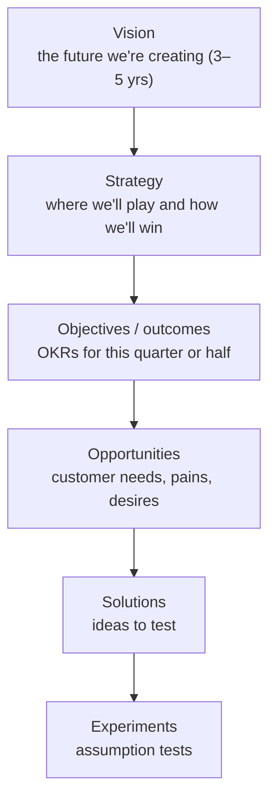
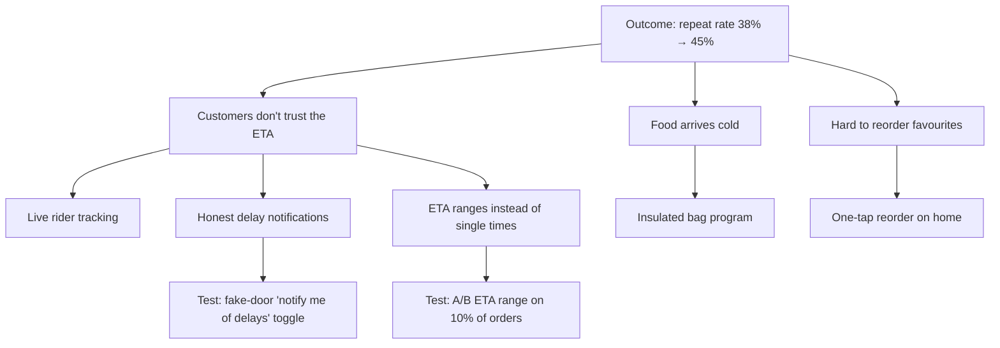

# Product Management: Discovery and Strategy

A product manager (PM) is responsible for making sure the team builds the **right** thing: something customers value, that works for the business, that is feasible to build, and that people can actually use. The PM doesn't own the solution alone. They own the clarity of the problem, the outcomes to achieve and the decisions about priorities. This guide covers product strategy, continuous discovery, validating ideas before building, and prioritisation, with templates you can use.

## 1. The four risks every product idea faces

| Risk | Question | Who leads |
|---|---|---|
| **Value** | Will customers buy or use it? | PM |
| **Usability** | Can they figure out how to use it? | Designer |
| **Feasibility** | Can we build it with our time, skills and technology? | Tech lead |
| **Viability** | Does it work for the business (legal, financial, brand, sales, support)? | PM with stakeholders |

The product trio (PM, designer and tech lead) works together to reduce these risks **before** committing engineering time to a full build.

## 2. Product strategy: from vision to bets



- **Vision:** "Every family in Bangladesh can get a good, affordable meal delivered reliably, on time."
- **Strategy:** a diagnosis, guiding policy and coherent actions. For example: "Our growth is limited by repeat orders in tier-2 cities because delivery is unreliable. We'll win by being the most reliable, not the cheapest: focus on dispatch quality and honest ETAs in Chattogram and Sylhet, and decline to compete on deep discounts."
- **Strategy means choosing what *not* to do.** A strategy that says yes to everything isn't one.

### Outcomes over outputs

Output: "Ship live rider tracking." Outcome: "Increase 30-day repeat order rate in Chattogram from 38% to 45%." Teams given outcomes can find the best solution, and live tracking may or may not be it.

**OKRs** express this:

```text
Objective: Make delivery in Chattogram reliably on time
  KR1: On-time delivery (within promised window) 78% → 90%
  KR2: "Where is my order?" support contacts per 1,000 orders 42 → 20
  KR3: 30-day repeat rate 38% → 45%
```

Key results are measurable outcomes, not a task list. Keep them few, ambitious but credible, and review them every week.

### North Star metric and inputs

A **North Star metric** captures the value customers get, and it predicts long-term success. For a delivery app that might be "orders delivered on time per week." It breaks down into **input metrics** that teams can influence: active customers × order frequency × on-time rate. A **metric tree** connects each team's work to the North Star.

## 3. Continuous discovery

Discovery isn't a phase before development. It's a weekly habit: talking to customers, mapping opportunities and testing assumptions alongside delivery.

### The opportunity solution tree



The tree keeps the team honest. Every solution should connect to a real customer opportunity, and every opportunity to the outcome. Compare **several solutions per opportunity** rather than falling for the first idea.

### Interviewing customers every week

Weekly customer touchpoints, even 2–3 short interviews, keep decisions grounded in real behaviour. Ask about specific past experiences ("Tell me about the last time your order was late"), not hypotheticals. See the UX research guide for technique.

## 4. Testing assumptions before building

Break each solution into its **assumptions**, and test the riskiest cheaply first:

| Solution | Riskiest assumption | Cheap test |
|---|---|---|
| Subscription with free delivery | Customers will pay ৳199/month | Landing page plus "join waitlist" with price shown, measuring the sign-up rate |
| ETA ranges | Ranges increase trust without reducing conversion | A/B test on 10% of traffic for 2 weeks |
| Group ordering for offices | Office managers coordinate group lunches and would use it | 8 interviews with office managers, plus a concierge test (handle 10 group orders manually over WhatsApp) |
| Insulated bags | Riders will use them consistently | Pilot with 30 riders in one zone and measure complaints |

Test types: **interviews, fake-door tests, landing pages, prototypes with users, concierge and Wizard-of-Oz tests** (a human does manually what the product would do automatically), **pilots**, and **A/B tests**. The principle: learn the most for the least cost, before writing production code.

Define **success criteria before running the test**: "If at least 4% of visitors join the waitlist at ৳199, we'll build a minimal version." Otherwise every result looks like success.

## 5. Prioritisation

Prioritisation means saying no to good ideas so you can do great ones. Frameworks support judgement, they don't replace it:

**RICE** = (Reach × Impact × Confidence) ÷ Effort

| Idea | Reach (orders/quarter) | Impact (0.25–3) | Confidence | Effort (person-weeks) | RICE |
|---|---|---|---|---|---|
| Honest delay notifications | 400,000 | 1 | 80% | 3 | 106,667 |
| Live rider tracking | 400,000 | 2 | 50% | 12 | 33,333 |
| One-tap reorder | 150,000 | 1 | 80% | 2 | 60,000 |
| Group ordering | 8,000 | 3 | 30% | 10 | 720 |

Other tools:

- **Kano model:** basic expectations (must work) vs performance features (more is better) vs delighters.
- **Cost of delay:** what we lose each week we don't ship it, which is useful for time-sensitive items (a regulation deadline, the Eid season).
- **Impact/effort matrix:** quick wins vs big bets.

Always check against strategy. A high-RICE idea that doesn't serve the current strategy may still be a "not now."

## 6. Understanding the market and the business

- **Customer segments and jobs to be done:** "When I'm commuting home tired, I want dinner sorted with minimal effort, so I can spend the evening with my kids."
- **Competitive analysis:** what alternatives customers use (including cooking at home or calling the restaurant directly), and where you're better or worse.
- **Unit economics:** average order value, take rate, delivery cost per order, customer acquisition cost (CAC) and lifetime value (LTV). A feature that raises conversion but adds ৳15 of cost per order may destroy value.
- **Pricing:** value-based, competitor-referenced, or cost-plus. Test it, and remember that pricing is part of the product.

## 7. Real-world case: live tracking vs honest notifications

A delivery team planned a 3-month live rider tracking project because "customers asked for it." Discovery interviews showed that what customers really wanted was **to not be surprised**. They could tolerate a delay if told early. A two-week test of proactive delay notifications ("Your order is running 10 minutes late because the restaurant is busy. New arrival 8:40 pm"), sent automatically when the ETA slipped by more than 5 minutes, cut "Where is my order?" contacts by 38% and improved repeat rate in the test group by 3 points. Live tracking was still built later, but as the second step, informed by the first.

## 8. Hands-on exercise

1. Write a one-paragraph product strategy for a product you use, including what it should *not* do.
2. Define one objective with 3 outcome-based key results.
3. Build an opportunity solution tree with 3 opportunities and 2–3 solutions each.
4. For your favourite solution, list 5 assumptions, choose the riskiest, and design a cheap test with success criteria.
5. Score 5 ideas with RICE, then explain one case where you'd override the score.

## 9. Checklist

- [ ] I can explain the four product risks and the role of the product trio.
- [ ] I can connect vision, strategy, outcomes (OKRs, North Star) and solutions, and I choose what not to do.
- [ ] I run continuous discovery with weekly customer contact and opportunity solution trees.
- [ ] I test the riskiest assumptions cheaply, with predefined success criteria.
- [ ] I prioritise with RICE, Kano and cost of delay, checked against strategy and unit economics.

## 10. Interview angle

> **Asked as:** "How do you decide what to build next?"

Start from the strategy and the outcome we're trying to move, the customer opportunities from discovery, and solutions compared per opportunity. Test the riskiest assumptions cheaply, prioritise with a framework like RICE plus judgement about strategy and cost of delay, and communicate the trade-offs.

> **Asked as:** "A big customer demands a feature. What do you do?"

Understand the underlying problem and its value, check how many other customers share it and whether it fits the strategy, explore alternative solutions, quantify the cost and opportunity cost, then decide transparently. Sometimes that means a clear, respectful "not now."
