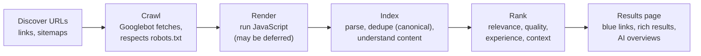

# Technical SEO: Crawling, Indexing, Rendering and Performance

Search engine optimisation (SEO) is how people find your site when they search, and technical SEO is the foundation that makes it possible. If search engines can't crawl, render and index your pages, or if the pages are slow and broken on mobile, great content won't rank. This guide covers how search works, crawl control, indexing signals, JavaScript rendering, site structure, structured data, page experience, and the tools that show what's happening, with code and configuration you can use directly.

## 1. How search works



Each step can fail. A page blocked by robots.txt is never crawled. A page with `noindex` is crawled but never indexed. A page whose content only appears after a client-side fetch might be indexed empty. A duplicate might be folded into another canonical URL. Technical SEO means making every step succeed for the pages that matter.

Google uses **mobile-first indexing**: it evaluates the mobile version of your pages, so content and structured data must be present on mobile, not only on desktop.

## 2. Controlling crawling

### robots.txt

```text
# https://quickfood.example/robots.txt
User-agent: *
Disallow: /cart
Disallow: /checkout
Disallow: /account
Disallow: /search?          # internal search results: infinite, low-value URLs
Allow: /

Sitemap: https://quickfood.example/sitemap.xml
```

- robots.txt controls **crawling, not indexing.** A disallowed URL can still appear in results (without a snippet) if other sites link to it. To keep a page out of the index, allow crawling and use `noindex`.
- Don't block CSS or JavaScript files that pages need to render.
- You can also address AI crawlers by their user-agents (for example `GPTBot`, `Google-Extended`, `ClaudeBot`, `PerplexityBot`) to opt in or out of AI training or answer use. Decide on a policy deliberately, because blocking some of them can also affect visibility in AI answer features.

### XML sitemaps

List the canonical, indexable URLs you want found, with accurate `lastmod` dates:

```xml
<?xml version="1.0" encoding="UTF-8"?>
<urlset xmlns="http://www.sitemaps.org/schemas/sitemap/0.9">
  <url>
    <loc>https://quickfood.example/dhaka/restaurants/kacchi-bhai-gulshan</loc>
    <lastmod>2026-10-09</lastmod>
  </url>
</urlset>
```

Generate sitemaps automatically from your database (maximum 50,000 URLs or 50 MB per file, so use a sitemap index for more), and submit them in Google Search Console and Bing Webmaster Tools.

### Crawl budget

For large sites (hundreds of thousands of URLs or more), wasted crawling on faceted filters, session IDs, endless calendars and duplicate parameters delays the discovery of important pages. Fix it with clean URL design, `noindex` or canonicals on low-value variants, robots rules for infinite spaces, and fast server responses.

## 3. Indexing signals

| Signal | Use |
|---|---|
| `<meta name="robots" content="noindex">` or the `X-Robots-Tag: noindex` header | Keep a page out of the index (thin pages, internal search, staging) |
| `<link rel="canonical" href="…">` | The preferred URL among duplicates (tracking parameters, sort orders, HTTP/HTTPS, trailing slashes) |
| `hreflang` | Language and region alternates (English and Bangla versions) |
| HTTP status codes | 200 (OK), **301/308** (permanent redirect, consolidates signals), 302/307 (temporary), **404/410** (gone), 5xx (server errors, which reduce crawling if they persist) |

```html
<head>
  <title>Kacchi Bhai, Gulshan: Menu & Delivery | QuickFood</title>
  <meta name="description" content="Order Kacchi Bhai's kacchi biryani, borhani and more in Gulshan. Live tracking, bKash & card, delivery in ~35 min.">
  <link rel="canonical" href="https://quickfood.example/dhaka/restaurants/kacchi-bhai-gulshan">
  <link rel="alternate" hreflang="en" href="https://quickfood.example/dhaka/restaurants/kacchi-bhai-gulshan">
  <link rel="alternate" hreflang="bn" href="https://quickfood.example/bn/dhaka/restaurants/kacchi-bhai-gulshan">
  <link rel="alternate" hreflang="x-default" href="https://quickfood.example/dhaka/restaurants/kacchi-bhai-gulshan">
</head>
```

Common mistakes: canonicals pointing to redirected or `noindex` pages, `hreflang` without return links, "soft 404s" (an error page returned with status 200), and accidentally shipping `noindex` from staging to production. Add a CI check for that last one.

## 4. JavaScript and rendering

Google renders JavaScript, but rendering can be delayed and resource-limited, and other crawlers (and many AI crawlers) execute little or no JavaScript. Choose your rendering strategy with SEO in mind:

| Strategy | SEO | Notes |
|---|---|---|
| **Static generation (SSG)** | Excellent | Pages pre-built as HTML. Ideal for content that changes rarely. |
| **Server-side rendering (SSR)** | Excellent | HTML per request. Good for dynamic content. |
| Incremental static regeneration / caching | Excellent | Static speed with periodic freshness |
| Client-side rendering (CSR, SPA) | Risky | The initial HTML is empty, and content depends on JavaScript execution |

Frameworks like **Next.js**, Nuxt, Astro, SvelteKit and Remix make SSR and SSG straightforward. If you must use a CSR single-page app:

- Make sure important content and links exist in rendered HTML that crawlers can see.
- Use real `<a href>` links, not `onClick` navigation. Crawlers follow hrefs.
- Give each page a unique URL with History API routing (no `#` fragments).
- Set a unique title, meta description and canonical per route.
- Return proper status codes. An SPA that returns 200 for every URL creates soft 404s, so render a `noindex` for unknown routes or handle them on the server.

```tsx
// Next.js (App Router): per-page metadata generated on the server
export async function generateMetadata({ params }: { params: Promise<{ city: string; slug: string }> }) {
  const { city, slug } = await params;
  const r = await getRestaurant(city, slug);
  if (!r) return { robots: { index: false } };
  return {
    title: `${r.name}, ${r.area}: Menu & Delivery | QuickFood`,
    description: `Order from ${r.name} in ${r.area}. ${r.topDishes.slice(0, 3).join(', ')}. Delivery in ~${r.etaMin} min.`,
    alternates: { canonical: `https://quickfood.example/${city}/restaurants/${slug}` },
  };
}
```

**Test it** with Search Console's URL Inspection tool (view crawled page, rendered HTML and screenshot), or by fetching the page with JavaScript disabled.

## 5. Site architecture and internal linking

- **A logical hierarchy:** Home → City → Area or cuisine → Restaurant. Important pages should be within 3–4 clicks of the homepage.
- **Descriptive, stable URLs:** `/dhaka/restaurants/kacchi-bhai-gulshan`, not `/r?id=8812&src=nav`. Use lowercase and hyphens.
- **Internal links with descriptive anchor text** pass context and authority. Hub pages (for example "Best biryani in Dhaka") link to relevant restaurants, and those link back.
- **Breadcrumbs** help users and search engines understand the structure.
- **Pagination and faceted navigation:** make paginated pages crawlable with plain links and self-referencing canonicals, and keep infinite filter combinations out of the index.
- **Migrations** (domain change, redesign, CMS move) are the riskiest SEO events. Map every old URL to its new equivalent with 301 redirects, keep the redirects for at least a year, update internal links and sitemaps, and monitor indexing and traffic closely.

## 6. Structured data

Structured data (JSON-LD using schema.org vocabulary) helps search engines understand entities and can make pages eligible for **rich results** (ratings, prices, breadcrumbs, events, products):

```html
<script type="application/ld+json">
{
  "@context": "https://schema.org",
  "@type": "Restaurant",
  "name": "Kacchi Bhai, Gulshan",
  "servesCuisine": ["Bangladeshi", "Biryani"],
  "address": { "@type": "PostalAddress", "streetAddress": "Road 11, Gulshan 2", "addressLocality": "Dhaka", "addressCountry": "BD" },
  "geo": { "@type": "GeoCoordinates", "latitude": 23.7925, "longitude": 90.4078 },
  "priceRange": "৳৳",
  "aggregateRating": { "@type": "AggregateRating", "ratingValue": "4.6", "reviewCount": "1284" },
  "url": "https://quickfood.example/dhaka/restaurants/kacchi-bhai-gulshan"
}
</script>
```

Rules: mark up only content visible on the page, keep it accurate, validate it with the Rich Results Test and the Schema Markup Validator, and monitor the enhancement reports in Search Console. Rich result eligibility changes over time (Google has retired or restricted several types), so treat it as a bonus, not a guarantee.

## 7. Page experience and Core Web Vitals

Speed and stability affect users directly and form part of Google's page experience signals:

| Metric | Measures | Good |
|---|---|---|
| **LCP** (Largest Contentful Paint) | Loading of main content | ≤ 2.5 s |
| **INP** (Interaction to Next Paint) | Responsiveness to input (replaced FID in 2024) | ≤ 200 ms |
| **CLS** (Cumulative Layout Shift) | Visual stability | ≤ 0.1 |

Measured at the 75th percentile of **real users** (field data from the Chrome UX Report) on mobile and desktop. Also required: HTTPS, no intrusive interstitials, and mobile-friendly layouts. The web performance guide covers fixes in depth: optimised hero images with `fetchpriority="high"`, reserved space for media and ads, reduced and deferred JavaScript, and caching with CDNs.

## 8. Tools

- **Google Search Console:** indexing coverage, URL Inspection, sitemaps, performance (queries, clicks, impressions, CTR, position), Core Web Vitals, manual actions. **Bing Webmaster Tools** is the equivalent for Bing, which also powers several AI assistants' search.
- **Crawlers:** Screaming Frog, Sitebulb, or open-source crawlers to audit status codes, titles, canonicals, depth and broken links at scale.
- **Server log analysis:** what Googlebot (verified by reverse DNS) actually crawls, and how often.
- **Lighthouse and PageSpeed Insights** (lab and field data), plus the `web-vitals` library for your own real-user monitoring.

## 9. Real-world case: the SPA that vanished from Google

A restaurant marketplace rebuilt its site as a client-rendered React SPA. Within two months, organic traffic had fallen 64%. URL Inspection showed rendered pages with an empty menu (the data came from an API after a 2-second delay), every route returned the same title, unknown URLs returned 200, and the navigation used `onClick` handlers instead of links. The fix: migrate the public pages to Next.js with server-rendered restaurant and city pages, unique metadata and canonicals, real links, proper 404s, a generated sitemap and Restaurant structured data. Within 10 weeks, indexed pages had recovered from 31% to 96% of the target URLs, and organic traffic exceeded its previous peak.

## 10. Hands-on exercise

1. Audit a site with a crawler: find broken links, redirect chains, missing or duplicate titles, wrong canonicals and pages deeper than 4 clicks.
2. Write robots.txt and a generated XML sitemap for a small app.
3. Add per-page metadata, canonicals and hreflang in a Next.js app, and verify the rendered HTML with JavaScript disabled.
4. Add JSON-LD structured data to one page type and validate it.
5. Set up Search Console for a site you own, submit the sitemap and inspect three URLs.

## 11. Checklist

- [ ] I understand discovery, crawling, rendering, indexing and ranking, and mobile-first indexing.
- [ ] I control crawling with robots.txt and sitemaps, and indexing with noindex, canonicals, hreflang and status codes.
- [ ] I choose SEO-friendly rendering (SSR or SSG) and make SPAs crawlable when needed.
- [ ] I design site architecture, URLs and internal linking, and I can run migrations safely.
- [ ] I implement valid structured data, meet Core Web Vitals and use Search Console and crawlers to monitor.

## 12. Interview angle

> **Asked as:** "Our new pages aren't showing up in Google. How do you investigate?"

Use URL Inspection: is the page discovered, crawlable (robots.txt), indexable (noindex, canonical pointing elsewhere), rendering its content, and returning 200? Check the sitemap, internal links to the page, duplicates, quality and server errors, then request indexing and monitor coverage.

> **Asked as:** "robots.txt Disallow vs noindex?"

Disallow stops crawling, but the URL can still be indexed from links, and Google can't see a noindex on a page it can't crawl. To remove a page from the index, allow crawling and use noindex (meta tag or header).
