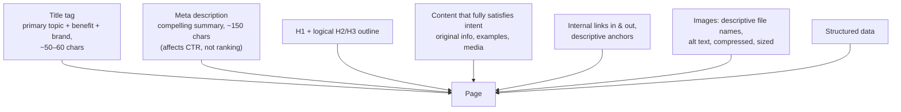
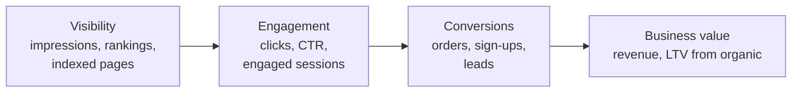

# Content, On-Page and Local SEO, Links, AI Search and Measurement

Technical SEO lets search engines find and understand your pages. Ranking depends on whether those pages are the **most helpful answer** to what people search for, and whether others trust you enough to link to and mention you. This guide covers keyword and intent research, on-page optimisation, content quality (E-E-A-T), local SEO for businesses with physical locations, link building, optimising for AI-powered search experiences, and measuring SEO properly.

## 1. Keyword research and search intent

Start from what your audience actually searches for, and **why**:

| Intent | Example query | Best page type |
|---|---|---|
| Informational | "how to make kacchi biryani" | Guide, recipe, video |
| Navigational | "quickfood login" | Login or home page |
| Commercial investigation | "best biryani in dhaka" | Comparison or list page with reviews |
| Transactional | "order biryani gulshan" | Restaurant or category page with ordering |
| Local | "biryani near me" | Local landing page plus Google Business Profile |

Process:

1. **Seed topics** from your product, customers' language (support tickets, reviews, sales calls) and competitors' rankings.
2. **Expand** with tools (Search Console queries, Google Keyword Planner, Ahrefs, Semrush, Google autocomplete and "People also ask"), and include Bangla and transliterated queries ("kacchi biriyani", "কাচ্চি বিরিয়ানি").
3. **Assess** search volume, difficulty, business value and intent. **Check the current results page.** If the top results are all recipes, a restaurant page won't rank for that query however well it's optimised.
4. **Cluster** related keywords into topics, with one primary page per intent. Don't create five near-identical pages for variations ("best biryani Dhaka" vs "top biryani Dhaka"), because that causes **keyword cannibalisation**.

## 2. On-page optimisation



A restaurant category page done well:

```html
<title>Best Biryani in Dhaka (2026): 25 Restaurants Ranked by Diners | QuickFood</title>
<meta name="description" content="Top-rated kacchi, tehari and chicken biryani across Dhaka, ranked by 48,000+ verified diner reviews, with prices, delivery times and areas.">

<h1>Best biryani in Dhaka, ranked by 48,000 diner reviews</h1>
<p>Updated 9 October 2026. Rankings use verified orders from the last 90 days…</p>

<h2>How we rank</h2>
<h2>Top 10 kacchi biryani restaurants</h2>
<h3>1. Kacchi Bhai, Gulshan: ★4.7 (2,104 reviews)</h3>
<p>Known for… Average price ৳380 · Delivery ~35 min · <a href="/dhaka/restaurants/kacchi-bhai-gulshan">Order from Kacchi Bhai Gulshan</a></p>
<h2>Best biryani by area</h2>
<h2>Kacchi vs tehari: what's the difference?</h2>
<h2>FAQs</h2>
```

Principles: one clear topic per page, the main answer early, scannable structure, original data (here, rankings from real order and review data that nobody else has), and links to deeper pages.

**Titles and descriptions** are your search-results advertisement. Google may rewrite them, especially when they're vague or stuffed with keywords, so write them for humans. Track click-through rate (CTR) by query in Search Console and improve pages with high impressions but low CTR.

## 3. Content quality: helpful content and E-E-A-T

Google's systems aim to reward **helpful, reliable, people-first content**. Its quality rater guidelines describe **E-E-A-T**:

- **Experience:** first-hand experience ("We ordered from all 25 restaurants…", real photos, original testing).
- **Expertise:** knowledge appropriate to the topic (a nutritionist for health claims, a chef for technique).
- **Authoritativeness:** recognition by others (mentions, links, reviews).
- **Trust** (the most important): accuracy, transparency (who wrote it, how rankings work), secure and honest business practices.

For "Your Money or Your Life" topics (health, finance, safety) the bar is much higher.

What tends to fail: thin pages generated from templates with swapped city names, content rewritten from other sites with nothing added, and **mass-produced AI content with no original value**. Google's spam policies target *scaled content abuse* whether it's made by people or by AI. AI can help with research, drafting and editing, but the page must add real value, be accurate and be reviewed by someone accountable.

**Content maintenance:** update or consolidate outdated pages (merge weak, overlapping articles into one strong page with 301 redirects), and prune pages that serve no purpose.

## 4. Local SEO

For businesses that serve people in specific places (restaurants, clinics, shops), local results and maps often matter more than standard blue links.

- **Google Business Profile (GBP):** a verified listing with an accurate name, address and phone number (**NAP**), categories, opening hours (including holiday and Ramadan hours), photos, menu or products, attributes (delivery, takeaway), and posts.
- **Reviews:** ask happy customers to leave reviews (never buy them, gate them or incentivise only positive ones), and reply to reviews, especially negative ones, quickly and constructively.
- **Consistent citations:** the same NAP across directories, social profiles and maps.
- **Location pages on your site:** a unique page per location with real local content (address, map, hours, local menu, directions, landmarks), not a duplicated template, plus `LocalBusiness` or `Restaurant` structured data.
- **Ranking factors:** relevance (does the profile match the search?), distance (from the searcher), and prominence (reviews, links, overall reputation).

For a delivery marketplace, local SEO also means city and area landing pages ("Biryani delivery in Dhanmondi") that list genuinely available restaurants, with real-time availability and delivery times. These are useful, not doorway pages.

## 5. Links and digital PR

Links from other reputable sites remain a strong signal of authority. Earn them, don't buy them:

- **Linkable assets:** original research and data ("Dhaka Food Delivery Report 2026: what the city ordered"), useful free tools (a calorie calculator, a party-food planner), and definitive guides.
- **Digital PR:** pitch newsworthy data stories to journalists and bloggers.
- **Partnerships:** restaurants linking to their QuickFood page, local organisations, sponsorships with genuine editorial value.
- **Unlinked mentions:** ask sites that mention your brand to add a link.

Avoid link schemes (paid links without `rel="sponsored"`, private blog networks, mass directory submissions, link exchanges). They risk manual actions and algorithmic devaluation. Use `rel="sponsored"` for paid placements and `rel="ugc"` for user-generated links.

## 6. Search with AI answers

Search increasingly includes AI-generated answers (Google's AI Overviews and AI Mode, Bing Copilot, plus assistants such as ChatGPT search and Perplexity) that summarise sources and cite some of them. What helps you get cited, sometimes called generative engine optimisation (GEO) or answer engine optimisation:

- The same fundamentals: crawlable, indexable, fast pages with clear, accurate, well-structured content.
- **Direct, quotable answers** near the top of sections, backed by specifics (numbers, dates, sources). Original data and first-hand experience are more likely to be cited than generic text.
- **Clear entities and structure:** headings that match questions, tables and lists for comparisons, structured data, and a consistent brand and author identity across the web.
- **Crawler access:** make sure the crawlers behind the answer engines you care about can reach your public content, and decide your robots policy deliberately.
- **Measure differently:** AI answers can reduce clicks for simple informational queries, so track impressions, brand searches, citations and referral traffic from AI assistants, and focus content on what can't be fully answered in a summary (tools, transactions, deep comparisons, local availability).

## 7. Measuring SEO



- **Google Search Console:** queries, pages, clicks, impressions, CTR and average position. Segment by page type (restaurant, city, guide) and by brand vs non-brand queries.
- **Analytics** (GA4 or privacy-friendly alternatives): organic sessions, conversions and revenue attributed to organic search.
- **Rank tracking** for priority keywords, by city or device.
- **Technical health:** indexed vs submitted pages, crawl errors, Core Web Vitals pass rate.
- **SEO tests:** for large sites, split-test template changes across similar page groups (half of the city pages get the new title format) and compare organic traffic with a control group.

Be patient but rigorous. SEO changes often take weeks to months to show, so annotate releases and algorithm updates, and judge by trends against a baseline.

```sql
-- Organic orders by landing page type (from analytics export joined to orders)
SELECT lp.page_type,
       count(DISTINCT s.session_id) AS organic_sessions,
       count(DISTINCT o.order_id) AS orders,
       round(100.0 * count(DISTINCT o.order_id) / nullif(count(DISTINCT s.session_id), 0), 2) AS conv_rate_pct,
       sum(o.total_bdt) AS revenue_bdt
FROM sessions s
JOIN landing_pages lp ON lp.url = s.landing_url
LEFT JOIN orders o ON o.session_id = s.session_id
WHERE s.channel = 'organic_search' AND s.started_at >= now() - interval '28 days'
GROUP BY lp.page_type
ORDER BY revenue_bdt DESC;
```

## 8. Real-world case: area pages that worked

A delivery marketplace had 400 auto-generated "Food delivery in [area]" pages with identical text and the area name swapped. They were thin doorway pages, mostly unindexed, and getting almost no traffic. The team rebuilt them around real, unique data: restaurants actually delivering to that area with live delivery times, the area's most-ordered dishes, average prices, local favourites, area-specific FAQs (delivery fees, late-night availability) and Restaurant structured data. Weak areas with too few restaurants were merged into their parent zone pages with redirects. Six months later, indexed area pages had gone from 22% to 91%, organic orders from area pages had grown 3.4×, and several pages were cited in AI Overviews for "food delivery in [area]" queries.

## 9. Hands-on exercise

1. Do keyword research for one topic: 30 keywords grouped by intent into 4–6 clusters, with the current results page type noted for each.
2. Write the title, meta description and H1/H2 outline for the primary page of one cluster.
3. Audit an existing page for E-E-A-T: what first-hand experience, expertise and trust signals could you add?
4. Set up or audit a Google Business Profile (yours or a friend's business) against the local SEO checklist.
5. Build a Search Console report of brand vs non-brand clicks by page type, and find 5 pages with high impressions and low CTR to improve.

## 10. Checklist

- [ ] I research keywords by intent, check the current results, cluster topics and avoid cannibalisation.
- [ ] I optimise titles, descriptions, headings, content, internal links and images for both people and search engines.
- [ ] I create helpful, original content with strong E-E-A-T signals, and avoid scaled low-value content.
- [ ] I can do local SEO (Google Business Profile, reviews, NAP, location pages) and earn links ethically.
- [ ] I adapt for AI answers and measure SEO from visibility to revenue, including controlled SEO tests.

## 11. Interview angle

> **Asked as:** "How would you grow organic traffic for a food delivery site?"

Fix the technical foundations (SSR, sitemaps, canonicals, speed), then map keyword intent to page types: city, area, cuisine and restaurant pages built on unique live data, plus data-driven guides. Add strong internal linking, structured data, local SEO and reviews, and earn links with original data. Measure by page type from impressions to orders, and test template changes.

> **Asked as:** "Is AI-generated content bad for SEO?"

Not inherently. Google evaluates helpfulness and quality, not the method of production. Mass-produced content with no added value violates its spam policies whoever made it. Use AI as an aid, add original expertise and data, have accountable people check accuracy, and publish only what genuinely helps users.
