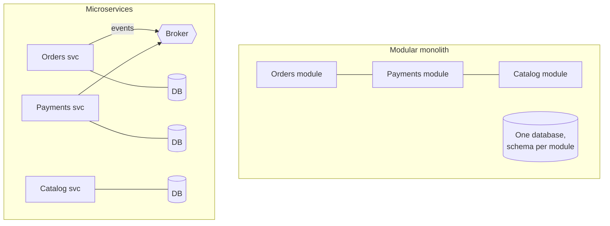
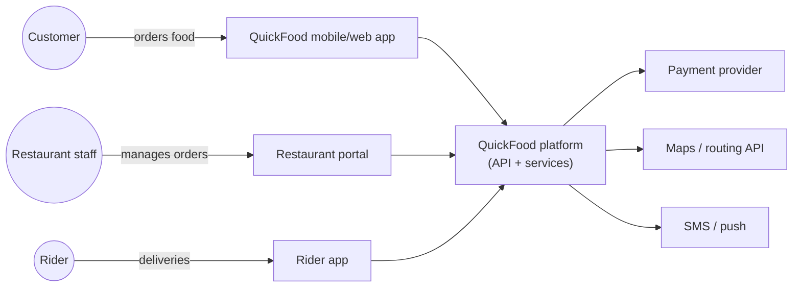

# Software Architecture: Quality Attributes, Styles and Decisions

Software architecture is the set of decisions that are expensive to change later: how a system is split into parts, how those parts communicate, where data lives, and what qualities (performance, availability, security, changeability) the system must have. A software architect's job is not drawing boxes. It is making these trade-offs explicit, deciding well under uncertainty, and making sure the decisions are understood and actually implemented. This guide covers quality attributes, the major architecture styles, and how to make and record decisions.

## 1. Architecture is driven by quality attributes

Functional requirements say *what* the system does. Architecture is mostly shaped by **quality attributes**, which say *how well*:

| Quality attribute | Concrete scenario (measurable) |
|---|---|
| Performance | Menu loads in under 300 ms at p95 with 2,000 requests per second |
| Availability | Ordering is available 99.95% of the time per month (about 22 minutes of downtime) |
| Scalability | Handles 10× order volume during iftar for 30 minutes |
| Modifiability | A new payment provider can be added in under 2 weeks by one team |
| Security | Customer PII is encrypted and accessible only to support roles, with an audit trail |
| Deployability | Each team deploys independently, several times a day |
| Observability | Any failed order can be traced end to end within 5 minutes |
| Cost | Infrastructure stays under 4% of gross order value |

Write them as **scenarios** (source, stimulus, environment, response, measure). "The system should be fast" can't guide a design. "p95 under 300 ms at 2,000 RPS" can.

Quality attributes **conflict**. Strong consistency costs availability and latency during network partitions (CAP and PACELC). More security layers cost latency and usability. Maximum flexibility costs simplicity. Architecture is choosing which trade-offs to make, *for this business*, now.

## 2. Architecture styles



| Style | Strengths | Costs | Good when |
|---|---|---|---|
| **Layered (n-tier)** | Simple, familiar | Changes ripple through layers, tends toward a big ball of mud | Small apps, CRUD |
| **Modular monolith** | One deployment, simple operations, strong module boundaries, easy refactoring | Must enforce boundaries, scales as one unit | Most products early on, small to medium teams |
| **Microservices** | Independent deployment and scaling, team autonomy, fault isolation | Distributed-systems complexity, data consistency, operations overhead | Many teams, clear domains, mature DevOps |
| **Event-driven** | Loose coupling, async scaling, audit trail | Harder debugging, eventual consistency | Workflows across domains, integration |
| **Hexagonal / clean architecture** | Domain logic independent of frameworks and I/O, testable | More indirection | Complex domain logic |
| **Serverless** | No servers, scales to zero, pay per use | Cold starts, vendor limits, harder local testing | Spiky or event-driven workloads, glue code |
| **Space-based / cell-based** | Extreme scale and isolation of failures | Complexity | Very large-scale, high-availability systems |

A common, healthy path: start with a **modular monolith** with clear domain boundaries. Extract services only where there's a real reason: independent scaling, a different team, a different reliability or compliance profile, or a different release cadence. "Microservices because Netflix" has sunk many small teams.

### Hexagonal architecture in code

```ts
// Domain core: no framework, no database imports
export interface PaymentGateway {                    // a port (interface owned by the domain)
  charge(orderId: string, amount: Money, idempotencyKey: string): Promise<ChargeResult>;
}
export interface OrderRepository {
  get(id: string): Promise<Order>;
  save(order: Order): Promise<void>;
}

export class PayForOrder {                           // a use case
  constructor(private orders: OrderRepository, private payments: PaymentGateway) {}
  async execute(orderId: string) {
    const order = await this.orders.get(orderId);
    order.assertPayable();                           // business rules live in the domain
    const res = await this.payments.charge(order.id, order.total, `pay:${order.id}`);
    order.markPaid(res.transactionId);
    await this.orders.save(order);
  }
}

// Adapters live at the edges: BkashGateway implements PaymentGateway, PgOrderRepository implements OrderRepository.
// Tests use in-memory fakes, so business rules are tested without HTTP or a database.
```

## 3. Integration and data decisions

- **Sync vs async:** synchronous calls (REST, gRPC) are simple but couple availability, because if Payments is down, Orders fails. Asynchronous events decouple, at the cost of eventual consistency.
- **Data ownership:** each service owns its data, and others access it through APIs or events, never by reading the database directly. Shared databases create hidden coupling.
- **Consistency across services:** use sagas (a sequence of local transactions with compensating actions) and the **transactional outbox** (write the event in the same transaction as the state change, then publish) instead of distributed transactions.
- **API style:** REST for resource APIs, gRPC for internal high-performance calls, GraphQL for flexible client-driven reads, and events for facts that others react to.

## 4. Making decisions under uncertainty

Good architects make decisions explicit, reversible where possible, and timely:

- **Identify the type of decision.** One-way doors (database engine, public API contract, data model of a core domain) deserve deep analysis. Two-way doors (a library choice behind an interface) should be made quickly.
- **Defer what you can,** without blocking teams. Keep options open with interfaces and boundaries.
- **Evaluate options against the quality-attribute scenarios**, not against popularity. ATAM-style workshops (Architecture Tradeoff Analysis Method) do this systematically for big decisions.
- **Spike or prototype** the riskiest assumption before committing.

### Architecture Decision Records (ADRs)

Record significant decisions in short Markdown files in the repository:

```markdown
# ADR-014: Use a transactional outbox for order events

Status: Accepted (2026-10-02)
Deciders: Orders team, platform architect

## Context
Orders must publish OrderPlaced/OrderCancelled to Kafka. Publishing after the DB commit
lost events during broker outages (3 incidents in Q3), causing missing rider assignments.

## Decision
Write events to an `outbox` table in the same transaction as the order change.
A relay (Debezium CDC) publishes outbox rows to Kafka. Consumers are idempotent by event id.

## Consequences
+ No lost events; ordering per order preserved (key = order_id)
+ Works during broker outages (events queue in the outbox)
- Extra table and relay to operate; at-least-once delivery requires idempotent consumers
- Slight publish latency (~1 s)

## Alternatives considered
Dual write with retries (rejected: still loses events on crash), Kafka transactions with DB (not possible across systems)
```

ADRs explain *why* the system is the way it is, which helps newcomers, prevents relitigating settled decisions, and makes revisiting them deliberate when the context changes.

## 5. Documenting architecture with C4

The **C4 model** gives four zoom levels, each for a different audience:

1. **Context:** the system, its users and the external systems it talks to. For everyone.
2. **Containers:** deployable units (web app, API, database, broker) and how they communicate. For developers and ops.
3. **Components:** the major parts inside one container.
4. **Code:** usually left to the IDE.



Keep diagrams as code (Structurizr DSL, Mermaid, PlantUML) next to the source, so they're reviewed and updated with it.

## 6. Real-world case: the premature microservices

A 9-engineer startup split its product into 14 microservices in its first year. Every feature touched 4–5 services, local development needed 20 containers, and a missed network timeout between two services caused the worst outage of the year. A review against quality attributes showed that their real drivers were *speed of change* and *low operational cost*, and both were hurt by the split. They consolidated into a modular monolith with 5 modules enforced by architecture tests, kept 2 genuinely separate services (real-time rider tracking, which needed different scaling, and payments, which had a separate compliance scope), and recorded each decision in ADRs. Lead time for changes dropped from 9 days to 2.

## 7. Hands-on exercise

1. Write six quality-attribute scenarios for a system you know, with measurable responses.
2. Draw C4 context and container diagrams as code (Mermaid or Structurizr).
3. Pick a real decision (database, sync vs async, monolith vs services) and write an ADR with context, decision, consequences and alternatives.
4. Refactor one feature into hexagonal style with a port, an adapter and an in-memory fake for tests.

## 8. Checklist

- [ ] I express requirements as measurable quality-attribute scenarios and reason about their trade-offs.
- [ ] I can compare layered, modular monolith, microservices, event-driven, hexagonal and serverless styles.
- [ ] I make integration and data-ownership decisions deliberately (sync vs async, outbox, sagas).
- [ ] I separate one-way-door from two-way-door decisions and record significant ones as ADRs.
- [ ] I communicate architecture at the right level with C4 diagrams as code.

## 9. Interview angle

> **Asked as:** "Monolith or microservices for a new product?"

Usually start with a modular monolith with strong domain boundaries: one deployment, simple operations, fast change. Extract services when there's a concrete driver such as independent scaling, team autonomy at scale, or different reliability or compliance requirements, and only once you have the DevOps maturity to run them.

> **Asked as:** "How do you make and communicate architecture decisions?"

Start from quality-attribute scenarios, evaluate options against them, prototype the risky parts, decide at the right level depending on reversibility, record decisions in ADRs, communicate with C4 diagrams, and verify with fitness functions and reviews.
