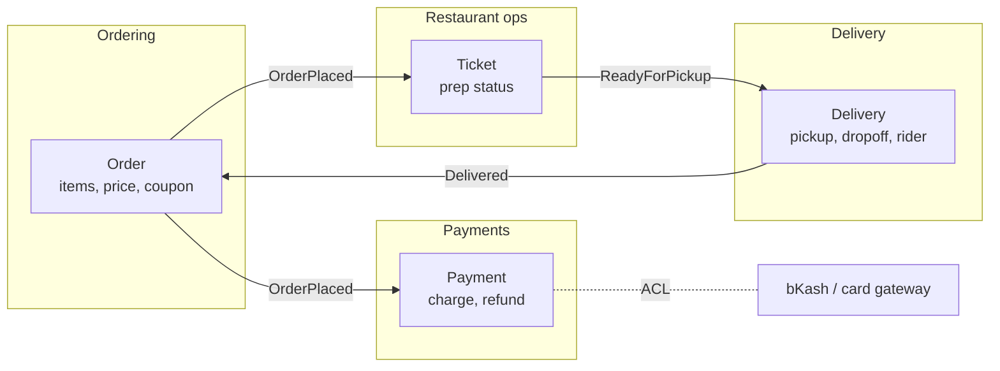
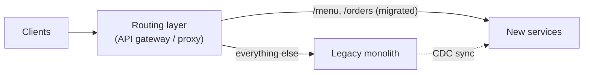

# Evolutionary Architecture, Governance and the Architect's Role

Architecture isn't a document you finish. Requirements change, teams grow, traffic multiplies and technology moves on. The architect's job shifts from designing a perfect system up front to **guiding continuous evolution**: keeping the important qualities intact while the system changes, aligning teams, managing technical debt and setting technical strategy. This guide covers fitness functions, domain-driven boundaries, migration patterns, lightweight governance, and the human side of the role.

## 1. Evolutionary architecture and fitness functions

A **fitness function** is an automated check that an architectural characteristic still holds. It turns "we care about X" into a test that fails the build.

| Characteristic | Fitness function |
|---|---|
| Module boundaries | Architecture tests: `orders` must not import `payments.internal` |
| Performance | Load test in CI: p95 of `create_order` under 800 ms |
| Dependency hygiene | No critical CVEs. Libraries no more than 2 major versions behind. |
| API compatibility | OpenAPI breaking-change check on every PR |
| Resilience | Chaos test: the Orders service survives Payments being down (orders queue) |
| Cost | Monthly cost per 1,000 orders below a threshold, alerting on drift |

```java
// ArchUnit (Java): enforce modular-monolith boundaries in a unit test
@AnalyzeClasses(packages = "com.quickfood")
class ArchitectureTest {
  @ArchTest
  static final ArchRule modules_only_talk_through_api =
      classes().that().resideInAPackage("..orders..")
          .should().onlyDependOnClassesThat()
          .resideInAnyPackage("..orders..", "..shared.kernel..", "..payments.api..", "java..", "org.springframework..");

  @ArchTest
  static final ArchRule domain_is_framework_free =
      noClasses().that().resideInAPackage("..domain..")
          .should().dependOnClassesThat().resideInAnyPackage("org.springframework..", "jakarta.persistence..");
}
```

Equivalent tools exist for other languages: `dependency-cruiser` and ESLint boundaries rules for TypeScript, `import-linter` for Python, and Spring Modulith for module verification in Spring Boot.

## 2. Finding the right boundaries with domain-driven design

Boundaries determine coupling, team structure and how easily the system changes. **Domain-Driven Design (DDD)** offers the tools:

- **Ubiquitous language:** the same terms in conversations, code and documents. "Order", "delivery" and "dispatch" mean precise things.
- **Bounded contexts:** areas where a model is consistent. "Order" in *Ordering* (items, price, coupon) is different from "Order" in *Delivery* (pickup point, drop-off, rider), so each context gets its own model.
- **Context mapping:** how contexts relate (customer/supplier, anti-corruption layer around a legacy or third-party system, shared kernel, published language through events).
- **Event storming:** a workshop in which domain experts and engineers map domain events on a wall ("Order placed", "Restaurant accepted", "Rider assigned"…) to discover processes, aggregates and boundaries.



**Conway's law:** systems mirror the communication structure of the organisation that builds them. Architects use it deliberately (the *inverse Conway manoeuvre*), shaping team boundaries to match the desired architecture: stream-aligned teams owning bounded contexts, and a platform team providing self-service infrastructure (Team Topologies).

## 3. Migrating legacy systems safely

Big-bang rewrites fail often: they take years, the old system keeps changing, and the cutover is enormous. Prefer incremental patterns:

- **Strangler fig:** put a routing layer in front of the legacy system and move functionality piece by piece to new components. The legacy system shrinks until it can be removed.
- **Branch by abstraction:** inside a codebase, introduce an interface, build the new implementation behind it, switch over with a flag, then delete the old one.
- **Parallel run:** run old and new side by side on real traffic and compare the results before switching (ideal for calculations like pricing and payroll).
- **Change data capture:** keep data synchronised between the old and new stores during the migration.



## 4. Technical debt as a portfolio

Technical debt is any design or implementation choice that makes future change more expensive. Some debt is deliberate and wise (ship now, refactor once you've learned). Unmanaged debt compounds. Practices:

- **Make it visible:** a debt register with impact ("adds about 2 days to every payments change", "caused 3 incidents") and estimated cost.
- **Prioritise by interest paid:** fix debt in the code that changes most often and hurts most. Hotspot analysis (change frequency × complexity, from Git history) finds it.
- **Budget for it continuously** (for example 15–20% of capacity) rather than hoping for a "refactoring quarter."
- **Tie it to business outcomes** when explaining it: lead time, incident rate and onboarding time, not "the code is ugly."

## 5. Lightweight governance

Heavy architecture review boards that approve everything slow teams down and get bypassed. Effective governance is mostly **enabling**:

- **Paved roads / golden paths:** templates and platforms that make the right way the easy way (a service template with logging, tracing, CI, security scanning and deployment built in).
- **Principles and guardrails** instead of approvals: "every service owns its data", "public APIs follow the API guidelines and pass the breaking-change check."
- **Architecture advice process:** anyone can make an architectural decision, provided they seek advice from affected people and experts and record it as an ADR.
- **A technology radar** (adopt, trial, assess, hold) to guide technology choices transparently.
- **Fitness functions** to enforce what matters automatically.

## 6. The architect's role and skills

| Skill | In practice |
|---|---|
| Technical breadth | Knowing enough about many technologies to see options and trade-offs |
| Technical depth in some areas | Credibility, and the ability to prototype risky parts |
| Communication | Explaining trade-offs to engineers, product managers and executives, each at their level |
| Facilitation | Running decision workshops and event storming, resolving disagreements |
| Business understanding | Connecting architecture to revenue, cost, risk and time to market |
| Pragmatism | "Good enough now, with a path to better" over perfect designs |

Effective architects **stay close to code** (pairing, reviewing, prototyping), measure the impact of decisions (DORA metrics, incident trends, cost) and grow other engineers' architectural thinking rather than being a bottleneck.

### Technical strategy

A useful strategy document is short: where we are (diagnosis, with data), where we need to be in 12–24 months and why (business drivers), the guiding principles, and a sequenced set of initiatives with measurable outcomes. Review it every quarter.

## 7. Real-world case: strangling a 12-year-old monolith

A logistics company's PHP monolith handled everything. Deployments happened monthly and took a weekend. A rewrite had already failed once. The new approach:

1. An event-storming workshop identified 7 bounded contexts. *Tracking* changed most often and caused most incidents, so it went first.
2. An API gateway routed `/tracking/*` to a new service, with CDC keeping shipment data in sync.
3. A parallel run compared ETA outputs for 3 weeks before switching.
4. Fitness functions were added: no new code in the monolith's tracking module (enforced in CI), plus p95 latency and contract tests.
5. ADRs recorded each step, and teams were re-formed around contexts.

Eighteen months later, 5 of 7 contexts had moved, deployments happened daily, and the monolith handled only billing, scheduled for the next year.

## 8. Hands-on exercise

1. Add architecture tests (ArchUnit, dependency-cruiser or import-linter) enforcing two boundary rules in a project.
2. Run a 1-hour event-storming session (alone or with friends) on a food-delivery domain and identify the bounded contexts.
3. Plan a strangler-fig migration for one legacy feature: routing, data sync, parallel run, cutover and rollback.
4. Build a hotspot analysis from Git history (`git log --format=format: --name-only | sort | uniq -c | sort -rn | head`) and combine it with complexity metrics.

## 9. Checklist

- [ ] I protect architectural characteristics with automated fitness functions.
- [ ] I use DDD (ubiquitous language, bounded contexts, context maps, event storming) to find boundaries, and I understand Conway's law.
- [ ] I can plan incremental migrations (strangler fig, branch by abstraction, parallel run, CDC).
- [ ] I manage technical debt as a prioritised portfolio tied to business outcomes.
- [ ] I govern through paved roads, principles, an advice process and ADRs, and I can write a technical strategy.

## 10. Interview angle

> **Asked as:** "How would you modernise a legacy monolith?"

Understand the domain and pain points first (event storming, hotspots, incident data). Prioritise the contexts with the highest change rate and pain, use a strangler fig with a routing layer, CDC and parallel runs, protect progress with fitness functions, align teams to contexts, and measure lead time and incidents. Avoid big-bang rewrites.

> **Asked as:** "How do you ensure teams follow architectural decisions without slowing them down?"

Make the right way the easy way with paved roads and templates, publish principles and a tech radar, use an advice process with ADRs, and enforce the critical rules automatically with fitness functions in CI, not with approval boards.
