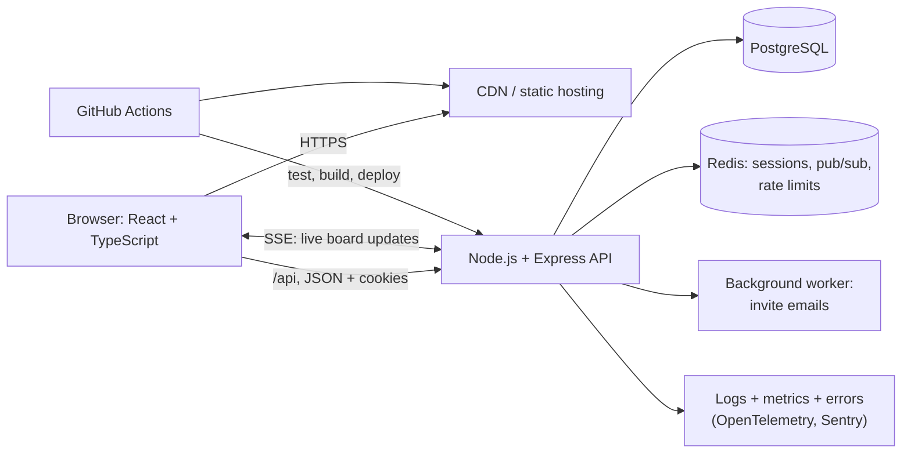

# Full-Stack Capstone: Build and Ship a Real App End to End

Reading about each layer separately is not the same as making them work together. This capstone walks you through building **TaskForge**, a small team task tracker, from an empty folder to a deployed, monitored production app. Every decision is explained, so you can apply the same path to your own project idea. Plan for two to three weekends.

## 1. What you will build

Users sign up, create projects, invite teammates, and manage tasks on a board with live updates when a teammate moves a card.



**Stack choices and why:**

| Layer | Choice | Reason |
|---|---|---|
| Frontend | React + TypeScript + Vite | Huge ecosystem, typed end to end |
| API | Node.js + Express (or Fastify) | Same language as the frontend, so shared types |
| Database | PostgreSQL | Relational data with constraints, JSONB when needed |
| Cache, pub/sub | Redis | Sessions, rate limits and fan-out for live updates |
| Auth | Session cookies (HttpOnly) | Simpler and safer than JWTs in localStorage for a first-party web app |
| Deploy | Docker images; a PaaS (Render/Fly/Railway) or a small VM | Production-like without running Kubernetes |

## 2. Step 1: model the data first

Get the schema right before writing endpoints. Most later pain comes from a weak data model.

```sql
CREATE TABLE users (
  id            bigint GENERATED ALWAYS AS IDENTITY PRIMARY KEY,
  email         citext UNIQUE NOT NULL,
  password_hash text NOT NULL,
  name          text NOT NULL,
  created_at    timestamptz NOT NULL DEFAULT now()
);

CREATE TABLE projects (
  id         bigint GENERATED ALWAYS AS IDENTITY PRIMARY KEY,
  name       text NOT NULL,
  owner_id   bigint NOT NULL REFERENCES users(id),
  created_at timestamptz NOT NULL DEFAULT now()
);

CREATE TABLE memberships (
  project_id bigint REFERENCES projects(id) ON DELETE CASCADE,
  user_id    bigint REFERENCES users(id) ON DELETE CASCADE,
  role       text NOT NULL CHECK (role IN ('owner', 'member', 'viewer')),
  PRIMARY KEY (project_id, user_id)
);

CREATE TABLE tasks (
  id          bigint GENERATED ALWAYS AS IDENTITY PRIMARY KEY,
  project_id  bigint NOT NULL REFERENCES projects(id) ON DELETE CASCADE,
  title       text NOT NULL CHECK (length(title) BETWEEN 1 AND 200),
  status      text NOT NULL DEFAULT 'todo' CHECK (status IN ('todo', 'doing', 'done')),
  position    numeric NOT NULL,             -- fractional ordering: insert between 1 and 2 with 1.5
  assignee_id bigint REFERENCES users(id),
  version     int NOT NULL DEFAULT 1,       -- optimistic locking
  updated_at  timestamptz NOT NULL DEFAULT now()
);
CREATE INDEX tasks_board ON tasks (project_id, status, position);
```

Key decisions: constraints in the database (not only in app code), a join table for many-to-many membership with roles, fractional `position` so reordering updates one row instead of renumbering all of them, and a `version` column to catch conflicting edits.

Manage the schema with **migrations** (node-pg-migrate, Prisma Migrate, Drizzle Kit), never hand-edited production SQL.

## 3. Step 2: the API

Design resources first, then implement:

```text
POST   /api/auth/signup | /login | /logout
GET    /api/projects                     list my projects
POST   /api/projects                     create
GET    /api/projects/:id/tasks           board
POST   /api/projects/:id/tasks           create task
PATCH  /api/tasks/:id                    move / edit (requires version)
GET    /api/projects/:id/events          SSE stream of board changes
```

The core of a move endpoint with authorisation, validation and optimistic locking:

```ts
import { z } from 'zod';

const MoveTask = z.object({
  status: z.enum(['todo', 'doing', 'done']),
  position: z.number(),
  version: z.number().int(),
});

app.patch('/api/tasks/:id', requireUser, async (req, res) => {
  const body = MoveTask.safeParse(req.body);
  if (!body.success) return res.status(422).json({ errors: body.error.flatten() });

  const task = await db.oneOrNone('SELECT project_id FROM tasks WHERE id = $1', [req.params.id]);
  if (!task || !(await canEdit(req.user.id, task.project_id))) return res.status(404).end(); // don't leak existence

  const updated = await db.oneOrNone(
    `UPDATE tasks SET status = $1, position = $2, version = version + 1, updated_at = now()
     WHERE id = $3 AND version = $4 RETURNING *`,
    [body.data.status, body.data.position, req.params.id, body.data.version],
  );
  if (!updated) return res.status(409).json({ error: 'Task changed, reload and retry' });

  await redis.publish(`project:${task.project_id}`, JSON.stringify({ type: 'task.updated', task: updated }));
  res.json(updated);
});
```

Things to get right: validate every input, check authorisation **per resource** (the most common real-world security bug is user A editing user B's task by changing the id in the URL), return 404 rather than 403 to avoid leaking which ids exist, and use 409 for conflicts.

## 4. Step 3: authentication and security baseline

- Hash passwords with **argon2id** or bcrypt, never store them in plain text or with fast hashes.
- Use session cookies with `HttpOnly; Secure; SameSite=Lax`, stored in Redis, and rotate the session id on login.
- **CSRF:** `SameSite=Lax` plus requiring a JSON content type covers most cases. Add CSRF tokens if you accept form posts.
- Rate-limit login and signup.
- Set security headers with `helmet` (Content-Security-Policy, HSTS).
- Keep secrets in environment variables from a secret store, never in the repo.

## 5. Step 4: the frontend

```tsx
// Data fetching and caching with TanStack Query, plus live updates over SSE
function Board({ projectId }: { projectId: string }) {
  const qc = useQueryClient();
  const { data: tasks = [] } = useQuery({
    queryKey: ['tasks', projectId],
    queryFn: () => api.get(`/projects/${projectId}/tasks`),
  });

  useEffect(() => {
    const es = new EventSource(`/api/projects/${projectId}/events`);
    es.onmessage = (e) => {
      const evt = JSON.parse(e.data);
      qc.setQueryData<Task[]>(['tasks', projectId], (old = []) =>
        old.map((t) => (t.id === evt.task.id ? evt.task : t)),
      );
    };
    return () => es.close();
  }, [projectId, qc]);

  const move = useMutation({
    mutationFn: (m: Move) => api.patch(`/tasks/${m.id}`, m),
    onMutate: async (m) => {                       // optimistic UI: move the card instantly
      await qc.cancelQueries({ queryKey: ['tasks', projectId] });
      const prev = qc.getQueryData<Task[]>(['tasks', projectId]);
      qc.setQueryData<Task[]>(['tasks', projectId], (old = []) => old.map((t) => (t.id === m.id ? { ...t, ...m } : t)));
      return { prev };
    },
    onError: (_e, _m, ctx) => qc.setQueryData(['tasks', projectId], ctx?.prev), // roll back on failure
  });

  return <Columns tasks={tasks} onMove={(m) => move.mutate(m)} />;
}
```

Include proper loading, empty and error states, make it keyboard accessible (drag-and-drop must have a keyboard alternative), and make it responsive.

## 6. Step 5: tests that give confidence

- **Unit:** pure logic such as fractional positions and permission checks.
- **Integration:** API endpoints against a real PostgreSQL in Docker (Testcontainers), including authorisation tests ("user B gets 404 on user A's task").
- **End to end:** one Playwright journey: sign up → create project → add task → move it.

## 7. Step 6: ship it

```dockerfile
# Multi-stage build: small, non-root runtime image
FROM node:22-alpine AS build
WORKDIR /app
COPY package*.json ./
RUN npm ci
COPY . .
RUN npm run build && npm prune --omit=dev

FROM node:22-alpine
WORKDIR /app
ENV NODE_ENV=production
COPY --from=build /app/node_modules ./node_modules
COPY --from=build /app/dist ./dist
USER node
EXPOSE 8000
CMD ["node", "dist/server.js"]
```

The GitHub Actions pipeline runs on every PR: install, typecheck, lint, unit and integration tests, build. On merge to `main` it also builds and pushes the image, runs migrations, deploys, and runs a smoke test against `/health`. Serve the frontend from a CDN with hashed assets cached for a year and `index.html` revalidated.

## 8. Step 7: operate it

- **Structured JSON logs** with a request id on every line.
- **Error tracking** (Sentry) on both frontend and backend, with source maps uploaded privately.
- **Metrics:** request rate, error rate, p95 latency, database pool usage.
- **Uptime check** on `/health` with an alert to your phone.
- **Backups:** managed PostgreSQL PITR, plus one restore test.

## 9. Real-world review: what interviewers look for in a capstone

Reviewers rarely care about the framework. They look for evidence of engineering judgement:

1. a README with an architecture diagram, setup in under five commands, and trade-offs explained,
2. a correct data model with constraints and migrations,
3. authorisation checks and tests for them,
4. CI running on every PR, and a live demo link,
5. one thing done deeply, such as live updates with conflict handling, and written up.

## 10. Hands-on milestones

1. Schema and migrations, plus seed data.
2. Auth and the projects API with integration tests.
3. Board UI with optimistic moves.
4. Live updates over SSE with Redis pub/sub, and conflict handling with 409.
5. Docker, CI/CD and a public deployment.
6. Monitoring, an error tracker and a written postmortem of one bug you hit.

## 11. Checklist

- [ ] I can design a relational schema with constraints and migrations.
- [ ] I implement validation, per-resource authorisation and optimistic locking.
- [ ] I build a frontend with cached server state, optimistic UI and live updates.
- [ ] I have unit, integration and end-to-end tests running in CI.
- [ ] My app is containerised, deployed, monitored and backed up.

## 12. Interview angle

> **Asked as:** "Walk me through a project you built end to end."

Cover the problem, the architecture diagram, the data model, one hard problem (for example concurrent edits handled with optimistic locking plus live updates), how you tested it, how it's deployed and monitored, and what you'd change at 100 times the scale.
