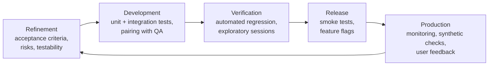
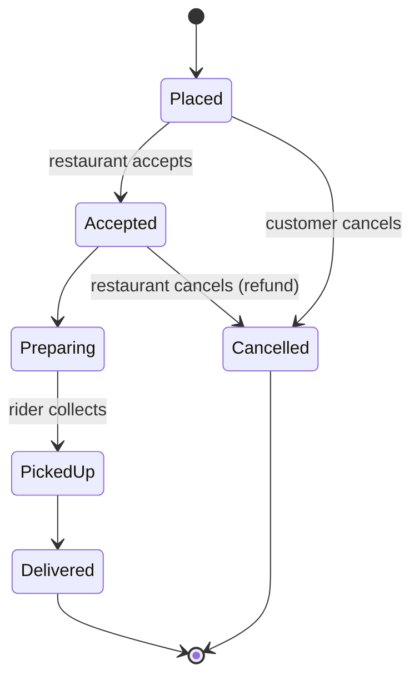

# QA Engineering: Test Design, Exploratory Testing and Bug Reporting

Quality assurance is more than "running tests." A QA engineer works out what could go wrong, designs the smallest set of tests that would reveal it, explores the product like a curious and slightly malicious user, and communicates problems so they get fixed. This guide covers the QA mindset, formal test-design techniques with worked examples, exploratory testing, bug reports that developers love, and how QA fits into agile delivery.

## 1. QA, QC and testing

- **Quality assurance (QA):** preventing defects through process: clear requirements, reviews, definitions of done, and test strategy from day one.
- **Quality control (QC):** finding defects in what was built, through testing and inspection.
- **Testing:** the activity of evaluating software to find information about its quality. A test can show the presence of bugs, never their absence.

Modern teams **shift left** (QA joins refinement and asks "how will we test this?" before code exists) and **shift right** (monitoring, feature flags and production checks).



## 2. Writing testable acceptance criteria

Vague: "Users can apply a coupon."

Testable, in Given/When/Then form:

```gherkin
Feature: Apply coupon at checkout

  Scenario: Valid percentage coupon on an eligible order
    Given a cart with items totalling ৳800 from "Kacchi Bhai"
    And the coupon "SAVE20" gives 20% off up to ৳120 on orders of ৳500 or more
    When the customer applies "SAVE20"
    Then the discount shown is ৳120
    And the total is ৳680 plus delivery fee

  Scenario: Order below the minimum
    Given a cart totalling ৳450
    When the customer applies "SAVE20"
    Then the coupon is rejected with "Add ৳50 more to use this coupon"
```

Writing scenarios like these during refinement surfaces questions early: Is the cap applied before or after VAT? Can coupons stack? What happens if the cart changes after the coupon is applied?

## 3. Test design techniques

You can't test every input, so these techniques pick the inputs most likely to reveal bugs.

### Equivalence partitioning

Group inputs that the system should treat the same way, and test one value from each group. For the order-quantity field (valid: 1–20):

| Partition | Example value |
|---|---|
| Below range (invalid) | 0 |
| Valid range | 7 |
| Above range (invalid) | 21 |
| Non-numeric (invalid) | "two" |

### Boundary value analysis

Bugs cluster at the edges (`<` vs `<=`). Test on, just below and just above each boundary: **0, 1, 2** and **19, 20, 21**. For the coupon's ৳500 minimum: ৳499.99, ৳500, ৳500.01.

### Decision tables

When the outcome depends on combinations of conditions:

| Rule | Logged in | First order | Coupon valid | → Free delivery | → Coupon applied |
|---|---|---|---|---|---|
| 1 | No | – | – | No (prompt login) | No |
| 2 | Yes | Yes | Yes | Yes | Yes |
| 3 | Yes | Yes | No | Yes | No (error) |
| 4 | Yes | No | Yes | No | Yes |
| 5 | Yes | No | No | No | No (error) |

Each rule becomes a test case, and gaps in the table reveal missing requirements.

### State transition testing

For anything with a lifecycle, such as an order:



Test every valid transition, and especially the **invalid** ones. Can a customer cancel after pickup through the API even if the button is hidden? Can a "Delivered" order go back to "Preparing" if two rider-app events arrive out of order?

### Pairwise (combinatorial) testing

With 4 browsers × 3 OSes × 3 payment methods × 2 languages there are 72 combinations. Most defects involve the interaction of at most two parameters, so **pairwise** tools (PICT, allpairspy) cover every pair in about 12–15 cases.

```python
from allpairspy import AllPairs
params = [["Chrome", "Safari", "Firefox", "Edge"], ["Android", "iOS", "Windows"],
          ["bKash", "Card", "Cash"], ["en", "bn"]]
for i, combo in enumerate(AllPairs(params), 1):
    print(i, combo)
```

### Error guessing and heuristics

Experience-based attacks: empty input, very long strings, emoji and Bangla script, leading and trailing spaces, special characters (`' " < > & ;`), double-clicking submit, the back button after payment, slow or offline networks, time zones and daylight saving, leap years, concurrent edits, and expired sessions mid-flow.

## 4. Exploratory testing

Scripted tests check what you expected. **Exploratory testing** finds what nobody expected: simultaneous learning, test design and execution, guided by a **charter**:

> **Charter:** Explore the *checkout flow* with *network interruptions and app backgrounding* to discover *payment state and duplicate-order problems*. Timebox: 60 minutes.

Session notes record what you tried, what you observed, bugs found, questions and ideas for automation. **Session-based test management** (charters, timeboxes, debriefs) makes exploration accountable without making it rigid.

Useful tours: the "money tour" (features customers pay for), the "landmark tour" (jump between key features in unusual orders), the "saboteur" (deny permissions, kill the network, fill the storage), and the "back-alley tour" (the least-used features).

## 5. Bug reports that get fixed

```text
Title: Duplicate order created when payment app returns after network drop (Android, bKash)

Environment: App 4.12.0 (build 812), Android 15, Pixel 7, staging, bKash sandbox
Severity: High (customer charged twice)    Priority: P1
Steps:
 1. Add any item, go to checkout, choose bKash
 2. In the bKash app, complete payment
 3. Before returning, enable airplane mode for ~5 s, then disable
 4. Return to the app
Expected: One order, one charge; app shows order status
Actual:   App shows "Payment failed, retry?"; tapping Retry creates a 2nd order and a 2nd charge
Frequency: 4/5 attempts
Evidence: screen recording, order ids o_88121 / o_88122, logcat excerpt, payment sandbox txn ids
Notes: Likely missing idempotency key on order creation retry
```

Qualities of a good report: one problem per report, minimal reliable steps, expected vs actual, environment and build, evidence, and impact. Separate **severity** (technical impact) from **priority** (business urgency). A typo on the home page is low severity but can be high priority.

## 6. Planning and risk-based testing

You never have time to test everything, so test by **risk = likelihood × impact**:

| Area | Impact | Likelihood of defects | Test depth |
|---|---|---|---|
| Payments, refunds | Very high | Medium (complex integrations) | Deep: automation, exploratory, contract tests |
| Order tracking | High | High (realtime, many states) | Deep |
| Profile settings | Low | Low | Light smoke |
| Marketing banner | Low | Low | Visual check |

A lightweight test strategy (one page per feature or release) covers scope, risks, test levels and types, environments and data, entry and exit criteria, and who does what.

**Metrics with care:** escaped defects (found in production), time to detect and fix, flaky-test rate and automation coverage of critical paths are useful. "Number of test cases" and "bugs found per tester" encourage the wrong behaviour.

## 7. Real-world case: the coupon that cost ৳9 lakh

A promotion "৳150 off orders over ৳600" launched on a Friday. Customers discovered that removing items *after* applying the coupon kept the discount, so ৳150 came off ৳200 orders. In one weekend that cost about ৳9 lakh. Boundary and state-transition thinking would have caught it: the coupon's validity must be re-evaluated on every cart change (a state transition), and the minimum is a boundary to test from both directions. The team added a decision table to every promotion story and an automated test, "modify cart after coupon → re-validate," to the regression suite.

## 8. Hands-on exercise

1. Write Given/When/Then acceptance criteria for "rider can mark an order as delivered with a photo."
2. Apply equivalence partitioning and boundary analysis to a phone-number field (Bangladesh mobile numbers) and a delivery-time-slot picker.
3. Draw the state diagram for a refund request and list five invalid transitions to test.
4. Run a 45-minute exploratory session on any web app with a written charter and session notes. File the two best bugs using the template.

## 9. Checklist

- [ ] I understand QA vs QC vs testing, and shift-left and shift-right practices.
- [ ] I write testable acceptance criteria and push for clarity during refinement.
- [ ] I apply equivalence partitioning, boundary values, decision tables, state transitions and pairwise testing.
- [ ] I run chartered, time-boxed exploratory sessions.
- [ ] I write clear, reproducible bug reports and plan testing by risk.

## 10. Interview angle

> **Asked as:** "How would you test a login page?"

Start from risks and requirements: functional cases (valid and invalid credentials, partitions and boundaries for the fields), security (rate limiting, lockout, generic error messages, SQL injection and XSS, session cookies), MFA and password reset flows, accessibility, browser and device coverage, performance under load, and state cases (expired session, back button, multiple tabs). Say what you'd automate and what you'd explore.

> **Asked as:** "Severity vs priority?"

Severity is the technical impact of the defect. Priority is how urgently the business needs it fixed. They often differ, for example a crash in a rarely used admin report (high severity, low priority).
