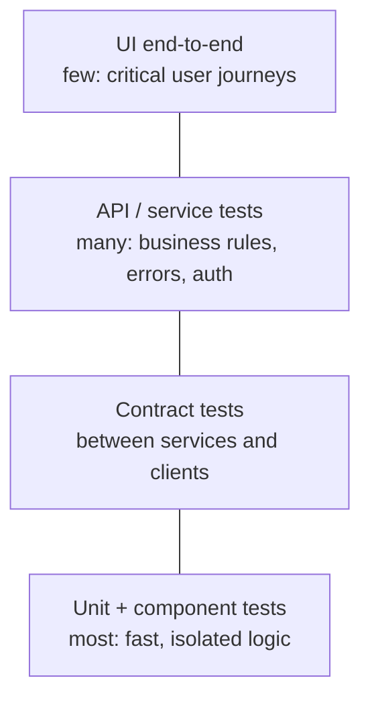

# API Testing, Performance Testing and Test Automation in CI

Manual testing doesn't scale to daily releases. Automation provides fast, repeatable regression checks, so humans can spend their time exploring. But badly chosen automation (slow, flaky UI tests for everything) becomes a burden. This guide covers API test automation, contract testing, performance and load testing with k6, test data and environments, and running it all in CI with quality gates and flake management.

## 1. Where automation pays off



API tests are the sweet spot for QA automation. They're fast (milliseconds), stable (no UI timing problems), and cover business rules, validation, authorisation and error handling directly. Keep UI end-to-end tests for a handful of critical journeys: sign up, search, order, pay, track.

## 2. API test automation

A readable, maintainable API test suite in TypeScript using Playwright's request fixture (the same idea works with pytest + httpx, REST Assured or Postman/Newman):

```ts
// tests/api/orders.spec.ts
import { test, expect, request } from '@playwright/test';

let customer, otherCustomer;
test.beforeAll(async () => {
  customer = await request.newContext({ baseURL: process.env.API_URL, extraHTTPHeaders: { Authorization: `Bearer ${await tokenFor('customer1')}` } });
  otherCustomer = await request.newContext({ baseURL: process.env.API_URL, extraHTTPHeaders: { Authorization: `Bearer ${await tokenFor('customer2')}` } });
});

test('creates an order and returns 201 with Location', async () => {
  const res = await customer.post('/v1/orders', {
    data: { restaurantId: 'r_17', items: [{ menuItemId: 'm_101', qty: 2 }] },
    headers: { 'Idempotency-Key': crypto.randomUUID() },
  });
  expect(res.status()).toBe(201);
  expect(res.headers()['location']).toMatch(/^\/v1\/orders\/o_/);
  const body = await res.json();
  expect(body).toMatchObject({ status: 'PLACED', items: [{ menuItemId: 'm_101', qty: 2 }] });
});

test('rejects invalid quantity with a problem+json error', async () => {
  const res = await customer.post('/v1/orders', { data: { restaurantId: 'r_17', items: [{ menuItemId: 'm_101', qty: 0 }] } });
  expect(res.status()).toBe(422);
  expect(res.headers()['content-type']).toContain('application/problem+json');
  expect((await res.json()).errors[0].field).toBe('items[0].qty');
});

test('a customer cannot read another customer\'s order (BOLA/IDOR)', async () => {
  const created = await (await customer.post('/v1/orders', { data: VALID_ORDER })).json();
  const res = await otherCustomer.get(`/v1/orders/${created.id}`);
  expect([403, 404]).toContain(res.status());
});

test('same Idempotency-Key does not create a duplicate', async () => {
  const key = crypto.randomUUID();
  const a = await customer.post('/v1/orders', { data: VALID_ORDER, headers: { 'Idempotency-Key': key } });
  const b = await customer.post('/v1/orders', { data: VALID_ORDER, headers: { 'Idempotency-Key': key } });
  expect((await a.json()).id).toBe((await b.json()).id);
});
```

What to cover for each endpoint: happy path, validation (partitions and boundaries), **authentication and authorisation** (no token, wrong role, other user's resource), error formats, idempotency, pagination and filtering, and **schema conformance** against the OpenAPI spec (Schemathesis can generate property-based tests straight from the spec).

```bash
schemathesis run https://staging.api.example/openapi.json --checks all --header "Authorization: Bearer $TOKEN"
```

## 3. Contract testing

When the mobile app, web app and three services all depend on the orders API, a field rename can break consumers you never tested. **Consumer-driven contract testing** (Pact) lets each consumer publish the exact interactions it relies on, and the provider verifies them in its own CI:

```ts
// In the rider app's tests (consumer)
await provider.addInteraction({
  states: [{ description: 'order o_1 is ready for pickup' }],
  uponReceiving: 'a request for a pickup order',
  withRequest: { method: 'GET', path: '/v1/orders/o_1' },
  willRespondWith: { status: 200, body: { id: 'o_1', status: 'READY', pickup: { lat: like(23.78), lng: like(90.41) } } },
});
```

The provider build fails if it would break any published contract, before deployment, without spinning up every service in a shared environment.

## 4. Performance and load testing

Performance testing answers "how fast, how many, and where does it break?":

| Type | Question | Shape |
|---|---|---|
| Load | Does it meet SLOs at expected peak? | Ramp to expected peak and hold |
| Stress | Where and how does it break? | Ramp beyond peak until failure |
| Spike | Can it absorb sudden bursts (an iftar rush, a push campaign)? | Jump from low to very high instantly |
| Soak | Leaks or degradation over hours? | Moderate load for 4–12 hours |

```js
// k6: checkout load test with SLO thresholds
import http from 'k6/http';
import { check, sleep } from 'k6';

export const options = {
  scenarios: {
    dinner_peak: {
      executor: 'ramping-arrival-rate',          // model requests per second, not just users
      startRate: 20, timeUnit: '1s', preAllocatedVUs: 200, maxVUs: 1000,
      stages: [
        { target: 150, duration: '5m' },          // ramp to expected peak
        { target: 150, duration: '15m' },         // hold
        { target: 400, duration: '2m' },          // spike
        { target: 0, duration: '3m' },
      ],
    },
  },
  thresholds: {
    'http_req_failed': ['rate<0.01'],                         // under 1% errors
    'http_req_duration{name:create_order}': ['p(95)<800'],    // SLO: p95 under 800 ms
    'http_req_duration{name:menu}': ['p(95)<300'],
  },
};

export default function () {
  const menu = http.get(`${__ENV.API}/v1/restaurants/r_17/menu`, { tags: { name: 'menu' } });
  check(menu, { 'menu 200': (r) => r.status === 200 });
  const res = http.post(`${__ENV.API}/v1/orders`, JSON.stringify(randomOrder()), {
    headers: { 'Content-Type': 'application/json', Authorization: `Bearer ${token()}`, 'Idempotency-Key': uuid() },
    tags: { name: 'create_order' },
  });
  check(res, { 'order 201': (r) => r.status === 201 });
  sleep(1);
}
```

Doing it right:

- **Test a production-like environment** (same instance sizes, data volumes, configuration), or carefully in production with synthetic accounts.
- **Use realistic traffic mixes and data:** a menu cache hit ratio from 1,000 identical requests is fiction.
- **Watch the system, not just k6:** CPU, memory, DB connections, slow queries, queue depth, GC pauses. The client tells you *that* it's slow, server metrics tell you *why*.
- **Percentiles, not averages**, and thresholds tied to SLOs, so the test passes or fails automatically.
- Run small performance smoke tests in CI on every merge, and full load tests before big events.

## 5. Test data and environments

- **Own your data:** tests create the data they need (via API or factories) and clean up, instead of depending on "user 42 in staging."
- **Isolate parallel runs:** unique ids per test run, separate tenants or schemas.
- **Ephemeral environments** per pull request (containers, preview deployments) remove "staging is broken by someone else."
- **Never copy raw production PII** into test environments. Use synthetic data or masked subsets.
- **Service virtualisation:** stub third parties (payment gateways, SMS) with WireMock or Mock Service Worker, plus a few tests against real sandboxes.

## 6. Automation in CI with quality gates

```yaml
# .github/workflows/test.yml (simplified)
jobs:
  unit:
    runs-on: ubuntu-latest
    steps: [{ uses: actions/checkout@v6 }, { run: npm ci }, { run: npm test -- --coverage }]
  api:
    needs: unit
    runs-on: ubuntu-latest
    services:
      postgres: { image: "postgres:18", env: { POSTGRES_PASSWORD: test }, ports: ["5432:5432"] }
    steps:
      - uses: actions/checkout@v6
      - run: npm ci && npm run db:migrate && npm run start:test &
      - run: npx playwright test tests/api --reporter=junit,html
      - run: npx pact-broker can-i-deploy --pacticipant orders-api --version $GITHUB_SHA --to-environment staging
  perf-smoke:
    needs: api
    runs-on: ubuntu-latest
    steps:
      - uses: grafana/setup-k6-action@v1
      - run: k6 run -e API=$PREVIEW_URL perf/smoke.js      # 2-minute run with thresholds
```

### Flaky tests

A flaky test passes and fails without code changes. Flakiness destroys trust ("just rerun it") and hides real bugs. Treat it as a defect:

- **Track it:** record retries and failure rates per test, and dashboards show the worst offenders.
- **Quarantine:** move a known-flaky test out of the blocking suite *with a ticket and an owner*, then fix it quickly.
- **Fix the root causes:** fixed sleeps (wait for conditions instead), shared test data, test order dependence, real time and time zones, external services, and race conditions in the app itself. Sometimes the "flaky test" is a real concurrency bug.

## 7. Real-world case: the iftar spike

A food delivery app passed its load test at 150 orders per second, but went down at 6:05 p.m. on the first day of Ramadan. Traffic had jumped from 40 to 380 orders per second within 90 seconds of iftar, and the load test had ramped gently over 5 minutes, so autoscaling and connection pools never faced a real spike. A new k6 spike scenario reproduced it. The database connection pool was exhausted while new pods started, and each new pod opened 50 connections. The fixes were PgBouncer, pre-scaling 20 minutes before iftar based on the calendar, a queue for order confirmation, and the spike test as a required gate before every Ramadan release.

## 8. Hands-on exercise

1. Write API tests for a CRUD endpoint covering validation boundaries, authorisation (another user's resource), error format and idempotency.
2. Run Schemathesis against an OpenAPI spec and triage what it finds.
3. Write a k6 test with load and spike scenarios and SLO thresholds. Watch server metrics while it runs.
4. Set up a Pact contract between a small consumer and provider, and break the provider to see verification fail.
5. Wire unit, API and performance-smoke stages into CI with JUnit reports.

## 9. Checklist

- [ ] I focus automation on API and contract tests, keeping UI end-to-end tests to critical journeys.
- [ ] My API tests cover validation, auth and authorisation, errors, idempotency and schema conformance.
- [ ] I can design load, stress, spike and soak tests with SLO-based thresholds and server-side monitoring.
- [ ] I manage test data and environments safely (no raw PII, isolated, ephemeral where possible).
- [ ] I run tests in CI with quality gates and treat flaky tests as defects.

## 10. Interview angle

> **Asked as:** "How do you decide what to automate?"

Automate stable, high-value, repeatable checks: critical business rules and regression at the API level, contracts between services, and a few end-to-end journeys. Keep exploratory testing human, consider the maintenance cost, and prioritise by risk and how often the code changes.

> **Asked as:** "Your load test passes but production falls over at peak. Why?"

The test wasn't realistic. Common gaps: a gentle ramp instead of a spike, an unrealistic data and cache mix, a smaller or different environment, missing third-party latency, or ignored server-side limits (connection pools, autoscaling lag). Fix the model, monitor the server during tests and add spike scenarios.
