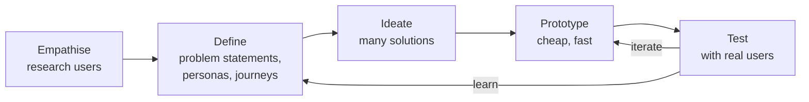

# UX Design: User Research and Human-Centred Design

User experience (UX) design is the practice of making products useful, usable and enjoyable for the people who use them. It starts long before visual design, with understanding who the users are, what they're trying to achieve and what gets in their way. This guide covers the human-centred design process, the main research methods with practical templates, and how to turn research into personas, journey maps and clear problem statements.

## 1. The human-centred design process



The **double diamond** describes the same rhythm: *diverge* to explore the problem widely, *converge* on the right problem, *diverge* to explore many solutions, then *converge* on the one that works. The most common failure in product teams is skipping the first diamond and polishing a solution to the wrong problem.

## 2. Choosing research methods

| Question | Method | Type |
|---|---|---|
| Who are our users, and what are their goals and pains? | **User interviews**, contextual inquiry | Qualitative, attitudinal |
| What do users actually do? | Analytics, session recordings, field observation | Quantitative / behavioural |
| Can people use this design? | **Usability testing** | Qualitative, behavioural |
| How many users feel or prefer X? | Surveys | Quantitative, attitudinal |
| How should content be organised? | **Card sorting**, tree testing | Mixed |
| Which version performs better? | A/B testing | Quantitative, behavioural |

Rule of thumb: **qualitative research explains *why*, quantitative research tells you *how many* and *how much*.** Combine them. Analytics show that 40% of users abandon checkout at the address step, interviews and usability tests reveal why (the map pin doesn't work on small phones), and an A/B test confirms the fix.

## 3. User interviews that produce insight

Interviews are about past behaviour, not opinions about the future. "Would you use a feature that…?" produces polite yeses. "Tell me about the last time you ordered dinner for your family" produces truth.

**Interview guide (food delivery, 45 minutes):**

```text
Warm-up (5 min)
  - Tell me a bit about your day and how meals usually happen at home.

Recent behaviour (20 min)
  - Walk me through the last time you ordered food online. What happened first?
  - How did you choose the restaurant? What else did you consider?
  - Was anything frustrating or confusing? What did you do then?
  - When did you last decide NOT to order online? Why?

Goals and context (10 min)
  - What matters most when ordering for your family vs for yourself?
  - How do you pay? Why that method?

Wrap-up (5 min)
  - If you could change one thing about ordering food, what would it be?
  - Is there anything I should have asked but didn't?
```

Techniques:

- Ask **open questions**, then follow up with "Why?", "Tell me more" and "What happened next?"
- **Don't lead** ("Wasn't the checkout confusing?") and don't pitch your idea.
- **Embrace silence.** People fill pauses with the interesting details.
- Recruit people who match the target segments, including non-users and people who churned. 5–8 interviews per segment usually reveal the main patterns.
- Record with consent, take notes on observations and quotes, and debrief immediately.

## 4. Synthesis: from notes to insights

Research is only useful once it's synthesised:

1. **Capture observations** on sticky notes, one fact or quote per note ("Opens 3 apps to compare delivery fees before ordering").
2. **Affinity mapping:** cluster the notes into themes, then name each theme as an insight.
3. **Write insights** as "Users [behaviour] because [motivation], which leads to [consequence]."

> *Insight:* Parents ordering for the family compare total cost across apps because delivery fees and minimum-order rules are hidden until checkout, which leads to abandoned carts and lower trust.

## 5. Personas, journey maps and problem statements

### Personas

A persona is a research-based archetype, not a made-up marketing character. Keep it focused on goals, behaviours, context and pain points:

```text
Rahima, 34, working parent in Mirpur, Dhaka
Goals:      Feed the family a reliable dinner on busy weekdays; stay within budget
Behaviour:  Orders 3–4×/week in the evening, mostly on Android, pays with bKash
Context:    Orders while commuting home on a bus, one hand, patchy 4G
Pains:      Surprise fees at checkout; late deliveries with no explanation; kids' food arrives cold
Quote:      "I just want to know the real total and when it will actually arrive."
```

### Customer journey map

A journey map shows the end-to-end experience across stages, with actions, thoughts, emotions, pain points and opportunities:

| Stage | Discover | Choose | Checkout | Wait | Receive |
|---|---|---|---|---|---|
| Actions | Opens the app on the bus | Browses, compares fees | Enters address, pays with bKash | Checks status repeatedly | Meets the rider at the gate |
| Thoughts | "What's fast tonight?" | "What's the real total?" | "Did the payment go through?" | "Why is it stuck on 'Preparing'?" | "Is it still hot?" |
| Emotion | 🙂 | 😐 | 😟 | 😠 | 🙂 / 😠 |
| Opportunities | Personalised "fast tonight" list | Show the total including fees upfront | Clear payment confirmation | Live rider tracking, honest delays | Insulated packaging, rating prompt |

Journey maps align teams (product, engineering, operations, support) around the *whole* experience, not their own screen.

### Problem statements and "How might we"

> **Rahima (busy working parent) needs to know the full cost and a realistic arrival time before she commits, because surprise fees and vague ETAs make her abandon orders and distrust the app.**

Then reframe it as opportunity questions for ideation: *How might we show the real total from the restaurant list? How might we make ETAs trustworthy, even when there are delays?*

## 6. Accessibility and inclusion are part of research

Include people with disabilities, older users, users with low digital literacy and users on low-end devices and slow networks in research. Designing for constraints (one hand, bright sunlight, Bangla script, screen readers, 2G fallback) improves the experience for everyone. Accessibility standards (WCAG 2.2 AA) are a baseline, not the goal. Watching a screen-reader user try your checkout is the fastest way to understand what's broken.

## 7. Research ethics and operations

- **Informed consent:** explain the purpose, recording and data use, and let people stop at any time.
- **Protect participant data:** anonymise notes, store recordings securely and delete them on schedule.
- **Compensate participants fairly.**
- **Build a research repository** (tagged insights, clips and reports) so knowledge accumulates instead of being lost in slide decks.

## 8. Real-world case: the checkout redesign that wasn't needed

A team planned a full checkout redesign because analytics showed 35% drop-off. Before designing, they ran 8 interviews and 6 remote usability tests. Most users weren't confused by the checkout at all. They were **shocked by the total**: delivery fee, small-order fee and a packaging charge appeared only at the last step, so they left to compare other apps. The team instead showed the estimated total (with fees) on restaurant cards and in the cart. Checkout completion rose 18% with a fraction of the redesign effort. Research saved months of work on the wrong problem.

## 9. Hands-on exercise

1. Write a 30-minute interview guide about a daily activity (commuting, ordering groceries, paying bills).
2. Interview 3 people. Capture observations and quotes.
3. Do affinity mapping and write 3 insights in the "because… which leads to…" format.
4. Create one persona and one journey map from your findings.
5. Write a problem statement and 5 "How might we" questions.

## 10. Checklist

- [ ] I can explain the human-centred design process and the double diamond.
- [ ] I can choose research methods by question (qualitative vs quantitative, attitudinal vs behavioural).
- [ ] I can run non-leading interviews about past behaviour and synthesise them into insights.
- [ ] I can create evidence-based personas, journey maps and problem statements.
- [ ] I include accessibility and ethics in research practice.

## 11. Interview angle

> **Asked as:** "How would you improve our app's onboarding?"

Don't jump to solutions. Look at funnel analytics to find where users drop off, then interview new and churned users and run usability tests to understand why. Synthesise, define the problem, ideate, prototype and test with users, then measure the impact with an experiment.

> **Asked as:** "Qualitative or quantitative research?"

Both. Quantitative shows what and how much (analytics, surveys, A/B tests). Qualitative explains why (interviews, usability tests). Use each to inform and validate the other.
