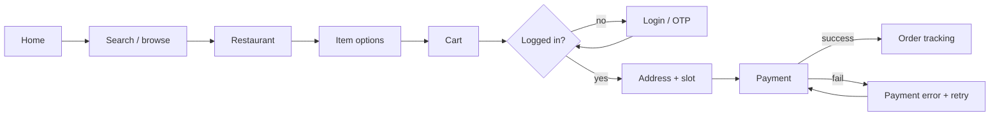

# Interaction Design, Prototyping, Usability Testing and Design Systems

Once you understand the problem, design turns insight into an interface people can use without thinking. This guide covers information architecture, interaction design principles and usability heuristics, wireframes and prototypes in Figma, running usability tests, and design systems that keep large products consistent and accessible, along with how designers and engineers work together.

## 1. Information architecture (IA)

IA organises and labels content so users can find things. Good IA uses the users' language and mental models, not the org chart.

- **Card sorting:** participants group content into categories they name themselves (open sort) or into predefined ones (closed sort). This reveals mental models.
- **Tree testing:** test a proposed menu structure without any visual design ("Where would you find refund status?"). It measures findability.
- **Sitemaps and user flows** document the structure and the paths through it.



Mapping flows *including error and edge paths* (failed payment, item unavailable, out of delivery zone) is where most usability problems are prevented.

## 2. Interaction design principles

- **Visibility of system status:** always show what's happening (loading, saved, order "Preparing" with a time).
- **Feedback:** every action gets an immediate response, such as a button press state, "Added to cart" or an inline validation message.
- **Affordances and signifiers:** things that are tappable look tappable.
- **Consistency:** the same action looks and behaves the same everywhere, which follows platform conventions (Material Design on Android, Human Interface Guidelines on iOS).
- **Constraints and error prevention:** disable impossible choices, use pickers for constrained input, and confirm destructive actions.
- **Recognition over recall:** show recent addresses and past orders instead of making people remember.
- **Hick's law:** decision time grows with the number of choices, so simplify and use progressive disclosure.
- **Fitts's law:** important targets should be large and within easy reach. Mobile primary actions belong in the thumb zone, with touch targets of at least 44–48 px.

**Nielsen's 10 usability heuristics** (system status, match with the real world, user control and freedom, consistency, error prevention, recognition over recall, flexibility, minimalist design, helping users recover from errors, help and documentation) are a quick checklist for a **heuristic evaluation**, where 3–5 evaluators review a design independently and then merge their findings.

### Writing for interfaces (UX writing)

Microcopy is design. Compare:

| Weak | Better |
|---|---|
| "Error 402" | "bKash payment didn't go through. You haven't been charged. Try again or choose another method." |
| "Submit" | "Place order · ৳680" |
| "Invalid input" | "Enter an 11-digit mobile number starting with 01" |

Be specific, human and action-oriented. Say what happened, whether the user's money or data is safe, and what to do next.

## 3. From sketches to prototypes

Match fidelity to the question you're trying to answer:

| Fidelity | Tool | Use to test |
|---|---|---|
| Paper sketches | Pen, paper | Many concepts quickly, flows |
| Wireframes (low fidelity) | Figma, Balsamiq | Layout, content hierarchy, IA |
| Clickable prototype (mid to high fidelity) | Figma prototypes | Flows and interactions with real users |
| Coded prototype | React, SwiftUI, Flutter | Complex interactions, real data, performance |

In **Figma**, use frames with **auto layout** (responsive, like Flexbox), **components with variants** (button: primary/secondary × default/hover/disabled), **variables** for colours, spacing and modes (light/dark), and **prototype connections** with smart animate for transitions. Keep design files organised so engineers can inspect them in Dev Mode.

## 4. Usability testing

Usability testing means watching real users try to complete realistic tasks with your design. It's the highest-value activity in UX.

**Plan:**

```text
Goal:         Can first-time users schedule a delivery for later today?
Participants: 5 per segment (e.g., new users on Android, mid-range phones)
Tasks:
  1. "You want lunch delivered to your office at 1 pm. Order a chicken biryani for that time."
  2. "You realise you'll be late. Change the delivery time to 1:30."
Metrics:      Task success, time on task, errors, Single Ease Question (1–7) after each task
Moderation:   Remote, think-aloud, 30 min
```

**Run:**

- Ask participants to **think aloud**. Don't help, and don't explain the design. If they ask "What does this do?", reply "What do you think it does?"
- Observe behaviour more than opinions. Where do they hesitate, backtrack or tap something that isn't interactive?
- Record with consent, and have teammates watch live. Seeing users struggle changes engineers' and PMs' minds faster than any report.

**Analyse and report:** list the issues with their severity (critical: blocks the task, serious, minor), frequency (4 of 5 participants) and evidence (clips, quotes), plus recommendations. **Five users typically uncover most of the major usability problems** in a given flow. Test, fix and test again rather than running one big study.

**Unmoderated testing** tools (Maze, Lyssna, UserTesting) scale to more participants and add quantitative metrics, while **benchmark studies** (System Usability Scale, task success over time) track improvement across releases.

## 5. Visual design essentials

- **Hierarchy:** size, weight, colour and spacing tell users what matters first.
- **Grid and spacing:** a consistent spacing scale (4/8-point) and layout grid.
- **Typography:** a limited type scale with readable sizes (body text 16 px or more on mobile) and line lengths of 45–75 characters. Check that fonts render Bangla script properly when you support it.
- **Colour:** a semantic palette (primary, success, warning, danger) with **contrast of at least 4.5:1** for text (WCAG AA). Never use colour as the only signal.
- **Motion:** purposeful and short (150–300 ms), and respect the user's "reduce motion" setting.

## 6. Design systems

A design system is the shared language of a product: **design tokens**, components, patterns and guidelines, in both design (a Figma library) and code (a component library).

```json
{
  "color": {
    "brand": { "primary": { "value": "#F97316" } },
    "text": { "default": { "value": "#111827" }, "muted": { "value": "#6B7280" } },
    "feedback": { "danger": { "value": "#DC2626" }, "success": { "value": "#16A34A" } }
  },
  "space": { "1": { "value": "4px" }, "2": { "value": "8px" }, "4": { "value": "16px" } },
  "radius": { "md": { "value": "10px" } }
}
```

Tokens flow from Figma variables into code (through Style Dictionary or a similar tool) as CSS variables, Android resources and iOS assets, so a brand colour change is one edit:

```tsx
// A design-system button: variants, sizes, accessible by default
export function Button({ variant = 'primary', size = 'md', loading, children, ...props }: ButtonProps) {
  return (
    <button
      className={cx('btn', `btn--${variant}`, `btn--${size}`)}
      aria-busy={loading || undefined}
      disabled={loading || props.disabled}
      {...props}
    >
      {loading ? <Spinner aria-hidden /> : null}
      <span>{children}</span>
    </button>
  );
}
```

Benefits: consistency, speed (no reinventing dropdowns), accessibility built in once, and a shared vocabulary between design and engineering. Costs: a team must own it, version it and support its adopters. Storybook documents and tests components in isolation, including visual regression and accessibility checks.

## 7. Designers and engineers working together

- Involve engineers early (in discovery and sketching), because feasibility and performance shape good design.
- **Design handoff is a conversation, not a file:** walk through flows, states (empty, loading, error, offline, long text, RTL or other scripts), responsive behaviour and accessibility notes.
- Review the built product against the design together before release (design QA).
- Measure outcomes after launch: task success, conversion, support tickets and satisfaction.

## 8. Real-world case: scheduled delivery

A team launched "schedule for later" hidden in a settings-style screen. Analytics showed only 2% of orders were scheduled, even though interviews suggested strong demand from office workers. A 5-person usability test showed that 4 of 5 participants never found the option and the fifth thought it changed the restaurant's opening hours. The redesign put a "Deliver: Now ▾ / Schedule" control directly in the cart, used plain language ("Deliver at 1:00–1:15 pm"), showed available slots as large chips in the thumb zone, and confirmed the time on the tracking screen. A second round of testing had 5 of 5 successes, and scheduled orders rose to 11% within a month.

## 9. Hands-on exercise

1. Run a 10-card open card sort with 5 people for a food-delivery app's help centre.
2. Map the checkout user flow, including at least 4 error and edge paths.
3. Build a clickable Figma prototype of one flow using auto layout and component variants.
4. Run a 5-user usability test with 2 tasks. Report the issues with severity, frequency and recommendations.
5. Define 10 design tokens and implement them as CSS variables used by a button and an input component.

## 10. Checklist

- [ ] I can structure IA with card sorting, tree testing and user flows that include error paths.
- [ ] I apply interaction principles, Nielsen's heuristics and good UX writing.
- [ ] I choose prototype fidelity by question and can build prototypes in Figma.
- [ ] I can plan, moderate and report usability tests.
- [ ] I understand visual design basics, accessibility contrast, and design systems with tokens and components.

## 11. Interview angle

> **Asked as:** "Walk me through your design process."

Use a real project: research (methods and key insights), the problem definition, ideation and why you chose one direction, prototypes at the right fidelity, usability testing and what changed as a result, collaboration with engineering, and measured outcomes after launch.

> **Asked as:** "How many users do you need for a usability test?"

Around 5 per distinct user group finds most major issues in a flow. Test iteratively (test, fix, retest) rather than running one large study, and use larger unmoderated or quantitative studies for benchmarks.
